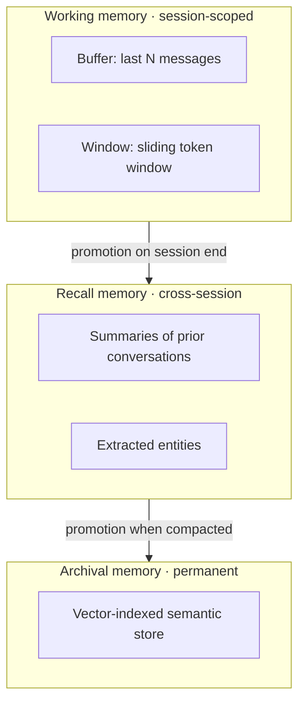
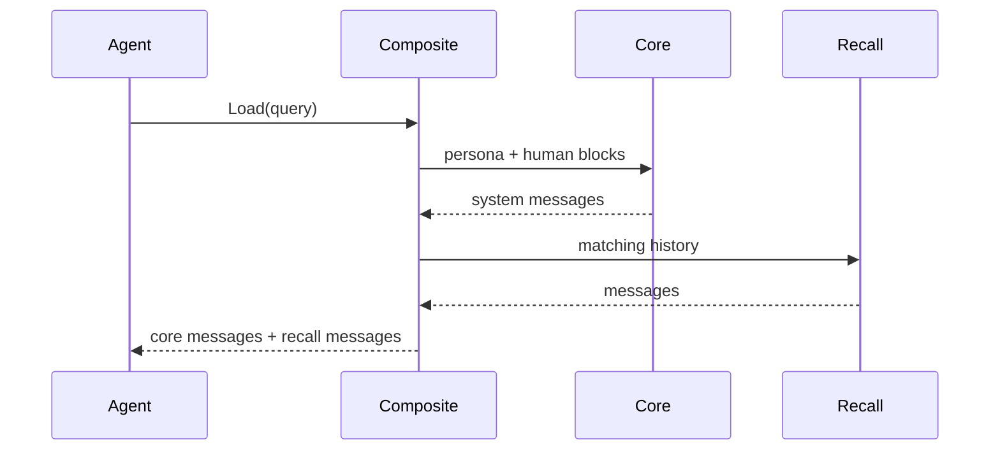
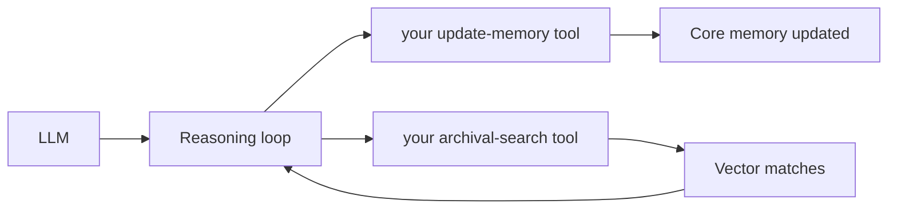

LLMs are stateless by default — every request starts with a blank slate. Without memory, an agent forgets everything the moment a conversation ends. Users must repeat their preferences, context gets lost across sessions, and the agent cannot build a long-term understanding of the people and topics it works with.

The `memory` package solves this with a **MemGPT-inspired 3-tier memory system**. [MemGPT](https://memgpt.ai/) (now Letta) is a research system that gives LLMs self-managed memory modeled after an operating system's memory hierarchy. Just as a CPU has registers (small, always available), RAM (larger, fast access), and disk (vast, searchable), an agent needs different memory tiers optimized for different access patterns and data volumes.

## Three-Tier Architecture

The memory system is organized into tiers that mirror a computer's memory hierarchy. Each tier serves a distinct purpose, and the system routes data to the appropriate tier based on access patterns and retention needs.

| Tier | Purpose | Analogy | Size |
|------|---------|---------|------|
| **Core** | Always in context — agent persona and user info | CPU registers (small, always available) | Small (< 2KB) |
| **Recall** | Searchable conversation history | RAM (recent, fast access) | Medium |
| **Archival** | Vector-based long-term storage | Disk (vast, searchable) | Unlimited |
| **Graph** | Entity-relationship knowledge | Relational index (structured connections) | Unlimited |



## The Memory Interface

All memory tiers implement the same `Memory` interface, which provides a uniform API for saving, loading, and searching across any backend. This consistency means you can swap memory implementations (in-memory for tests, Redis for production) without changing application code — the same registry pattern used throughout Beluga AI.

```go
type Memory interface {
	Save(ctx context.Context, input, output schema.Message) error
	Load(ctx context.Context, query string) ([]schema.Message, error)
	Search(ctx context.Context, query string, k int) ([]schema.Document, error)
	Clear(ctx context.Context) error
}
```

| Method | Purpose |
|--------|---------|
| `Save` | Persist an input/output message pair |
| `Load` | Retrieve relevant messages for a query |
| `Search` | Find documents in long-term storage |
| `Clear` | Reset all stored data |

## Core Memory

Core memory solves the problem of persistent identity: who is this agent, and who is it talking to? Like CPU registers that hold the most frequently accessed values, core memory blocks are always included in every LLM request. This makes them ideal for small, high-value data — the agent's persona and key facts about the current user — that should influence every response.

Because core memory is included in every context window, it must remain small (typically under 2KB). Storing large amounts of data here would waste token budget that should be used for conversation history and retrieved context.

```go
import "github.com/lookatitude/beluga-ai/v2/memory"

core := memory.NewCore(memory.CoreConfig{
	PersonaLimit: 2000,  // Max chars for persona block
	HumanLimit:   2000,  // Max chars for human block
	SelfEditable: true,  // Agent can modify its own memory
})

// Set the persona block
err := core.SetPersona("I am a financial advisor specializing in retirement planning.")
if err != nil {
	log.Fatal(err)
}

// Set the human block (information about the user)
err = core.SetHuman("Name: Alice. Age: 35. Risk tolerance: moderate. Goal: retire at 60.")
if err != nil {
	log.Fatal(err)
}

// Core memory converts to system messages for the LLM
msgs := core.ToMessages()
// Returns:
//   [Persona] I am a financial advisor...
//   [Human] Name: Alice. Age: 35...
```

`SelfEditable` records whether the agent is allowed to rewrite these blocks (check it with `core.IsSelfEditable()`). Beluga does not inject memory-editing tools for you; if you want the agent to update its own blocks, expose `SetPersona`/`SetHuman` as a tool (for example with `tool.NewFuncTool`) and gate it on that flag.

## Recall Memory

Recall memory addresses the problem of conversation continuity. Users expect agents to remember what was discussed in previous turns and sessions, but LLM context windows are finite. Recall memory stores the full conversation history in a searchable backend and retrieves the most relevant past messages for each new query. This is analogous to RAM — not everything fits in the context window at once, but recent and relevant data can be loaded quickly.

```go
import "github.com/lookatitude/beluga-ai/v2/memory/stores/inmemory"

// Recall takes any MessageStore backend (in-memory, Redis, PostgreSQL, ...).
recall := memory.NewRecall(inmemory.NewMessageStore())

// Save a conversation turn
err := recall.Save(ctx,
	schema.NewHumanMessage("What's my portfolio value?"),
	schema.NewAIMessage("Your portfolio is currently valued at $125,000."),
)
if err != nil {
	log.Fatal(err)
}

// Load past messages that match a query
msgs, err := recall.Load(ctx, "portfolio")
if err != nil {
	log.Fatal(err)
}
```

## Archival Memory

Archival memory handles long-term knowledge that goes beyond conversation history. When a user mentions important facts — deadlines, preferences, project details — the agent needs to store these in a way that can be retrieved semantically months later. Archival memory uses vector embeddings for storage, enabling similarity search over arbitrary text. This is the "disk" tier: virtually unlimited capacity with content-addressable retrieval.

```go
archival, err := memory.NewArchival(memory.ArchivalConfig{
	VectorStore: store,    // any vectorstore.VectorStore
	Embedder:    embedder, // any embedding.Embedder
})
if err != nil {
	log.Fatal(err)
}

// Save information for long-term storage
err = archival.Save(ctx,
	schema.NewHumanMessage("Remember that my daughter Sarah starts college in 2028."),
	schema.NewAIMessage("I'll remember that."),
)
if err != nil {
	log.Fatal(err)
}

// Search long-term memory
docs, err := archival.Search(ctx, "when does Sarah start college", 5)
if err != nil {
	log.Fatal(err)
}
for _, doc := range docs {
	fmt.Println(doc.Content)
}
```

## Graph Memory

Vector similarity search excels at finding topically related content, but it cannot capture structured relationships between entities. If a user mentions "Bob manages the AI team at TechCorp," a vector search for "who works at TechCorp" might return that passage, but it cannot traverse the relationship graph to answer "who reports to Bob?" or "what teams exist at TechCorp?"

Graph memory solves this by storing entities and relationships as nodes and edges in a graph database through the `memory.GraphStore` interface (`AddEntity`, `AddRelation`, `Query`, `Neighbors`). This enables relationship traversal, multi-hop reasoning, and structured queries that pure vector search cannot support. Beluga does not extract entities from conversations automatically; your application (or an LLM extraction step you write) decides what to add.

```go
import "github.com/lookatitude/beluga-ai/v2/memory/stores/neo4j"

graphStore, err := neo4j.New(neo4j.Config{
	URI:      "neo4j://localhost:7687",
	Username: "neo4j",
	Password: os.Getenv("NEO4J_PASSWORD"),
})
if err != nil {
	log.Fatal(err)
}
defer graphStore.Close(ctx)

// Store the facts from "My colleague Bob manages the AI team at TechCorp."
if err := graphStore.AddEntity(ctx, memory.Entity{ID: "bob", Type: "person"}); err != nil {
	log.Fatal(err)
}
if err := graphStore.AddEntity(ctx, memory.Entity{ID: "ai-team", Type: "team"}); err != nil {
	log.Fatal(err)
}
if err := graphStore.AddRelation(ctx, "bob", "ai-team", "MANAGES", nil); err != nil {
	log.Fatal(err)
}

// Traverse: everything within one hop of Bob
entities, relations, err := graphStore.Neighbors(ctx, "bob", 1)
if err != nil {
	log.Fatal(err)
}
fmt.Println(len(entities), len(relations))
```

## Loading memory

On each turn, composite memory's `Load` returns the core blocks (always in context) followed by the recall messages that match the query. Archival memory is queried separately through `Search`, and graph memory through the `GraphStore` methods. The agent sees one message list for core and recall.



## Agent-controlled memory

Beluga does not inject memory tools automatically. To get the MemGPT pattern, where the agent updates its own memory during reasoning, wrap the memory operations you want to expose (for example `Core.SetHuman` or `Archival.Search`) as tools with `tool.NewFuncTool` and pass them to the agent with `agent.WithTools`.



## Composite Memory

In practice, agents need all memory tiers working together. Composite memory combines Core, Recall, Archival, and Graph into a single `Memory` implementation that dispatches operations to the appropriate tier. Every tier is optional. `Save` writes the turn to Recall and Archival (Core is changed only through explicit edits). `Load` returns the Core blocks followed by matching Recall messages, and `Search` queries Archival. The graph store is held for direct access through `Graph()`.

```go
composite := memory.NewComposite(
	memory.WithCore(core),
	memory.WithRecall(recall),
	memory.WithArchival(archival),
	memory.WithGraph(graphStore),
)

// Save writes to the recall and archival tiers
if err := composite.Save(ctx, input, output); err != nil {
	log.Fatal(err)
}

// Load returns core blocks + matching recall messages
msgs, err := composite.Load(ctx, "portfolio performance")
if err != nil {
	log.Fatal(err)
}

// Search queries the archival tier
docs, err := composite.Search(ctx, "Sarah college", 5)
if err != nil {
	log.Fatal(err)
}
```

## Memory Store Providers

Storage backends are separate packages under `memory/stores/`. Message stores (`MessageStore`) back the Recall tier and graph stores (`GraphStore`) back the Graph tier; each package has its own `New(Config)` constructor. Because Recall only depends on the `MessageStore` interface, you can use the in-memory store during development and switch to Redis or PostgreSQL in production without changing application logic. The `memory.New()` registry has the built-in names `core`, `recall`, `archival`, `composite`, and `inmemory` (registered by importing `memory/stores/inmemory`).

| Provider | Import Path | Tiers | Best For |
|----------|-------------|-------|----------|
| In-Memory | `memory/stores/inmemory` | Recall, Graph | Development, testing |
| Redis | `memory/stores/redis` | Recall | Fast, distributed |
| PostgreSQL | `memory/stores/postgres` | Recall | Relational, durable |
| SQLite | `memory/stores/sqlite` | Recall | Embedded, single-node |
| MongoDB | `memory/stores/mongodb` | Recall | Document-oriented |
| Neo4j | `memory/stores/neo4j` | Graph | Enterprise graph DB |
| Memgraph | `memory/stores/memgraph` | Graph | Lightweight graph DB |
| Dragonfly | `memory/stores/dragonfly` | Recall | Redis-compatible |

## Using Memory with Agents

The most common use case is wiring memory into an agent's turn loop so that conversations are persisted and recalled across sessions. Load relevant context before calling the model, then save the turn afterwards. (`agent.WithMemory` takes a different, session-keyed `agent.Memory` interface, which `memory.Memory` does not implement, so wire the memory tiers explicitly as shown.)

```go
import (
	goredis "github.com/redis/go-redis/v9"

	"github.com/lookatitude/beluga-ai/v2/memory"
	"github.com/lookatitude/beluga-ai/v2/memory/stores/redis"
	"github.com/lookatitude/beluga-ai/v2/schema"
)

// Create Redis-backed recall memory
store, err := redis.New(redis.Config{
	Client: goredis.NewClient(&goredis.Options{Addr: "localhost:6379"}),
	Key:    "beluga:assistant:alice", // one key per user or session
})
if err != nil {
	log.Fatal(err)
}
mem := memory.NewComposite(
	memory.WithCore(core),
	memory.WithRecall(memory.NewRecall(store)),
)

// One conversation turn
userInput := "What are my preferences?"
history, err := mem.Load(ctx, userInput)
if err != nil {
	log.Fatal(err)
}
human := schema.NewHumanMessage(userInput)
resp, err := model.Generate(ctx, append(history, human))
if err != nil {
	log.Fatal(err)
}
if err := mem.Save(ctx, human, resp); err != nil {
	log.Fatal(err)
}
fmt.Println(resp.Text())
```

## Production Configuration

Production deployments require durable storage and connection pooling. Each store takes a client or connection you create and configure yourself, so pooling, TLS, and timeouts are set on that client.

### Redis

```go
client := goredis.NewClient(&goredis.Options{
	Addr:     "redis-cluster:6379",
	DB:       0,
	PoolSize: 20,
})
store, err := redis.New(redis.Config{Client: client, Key: "beluga:messages"})
if err != nil {
	log.Fatal(err)
}
recall := memory.NewRecall(store)
```

The Redis store does not set a TTL on the key; apply expiry with your Redis client if your data retention policy needs it.

### PostgreSQL with Connection Pool

```go
import (
	"github.com/jackc/pgx/v5/pgxpool"

	"github.com/lookatitude/beluga-ai/v2/memory/stores/postgres"
)

pool, err := pgxpool.New(ctx, os.Getenv("DATABASE_URL"))
if err != nil {
	log.Fatal(err)
}
defer pool.Close()

store, err := postgres.New(postgres.Config{DB: pool, Table: "agent_memory_messages"})
if err != nil {
	log.Fatal(err)
}
if err := store.EnsureTable(ctx); err != nil {
	log.Fatal(err)
}
recall := memory.NewRecall(store)
```

## Memory Middleware

Memory middleware follows the same `func(T) T` pattern used throughout Beluga AI for composable behavior wrapping. Middleware can add logging, metrics, encryption, or access control around any memory implementation without modifying the underlying store. Middleware is applied outside-in: the last middleware in the list becomes the outermost wrapper.

```go
// Wrap memory with OpenTelemetry tracing and lifecycle hooks
var wrapped memory.Memory = memory.ApplyMiddleware(mem,
	memory.WithTracing(),
	memory.WithHooks(hooks),
)
```

## Memory Hooks

Hooks provide lifecycle observation without wrapping the memory implementation. Unlike middleware, which intercepts and potentially modifies behavior, hooks are for observation and auditing. Each hook field is optional — nil hooks are skipped with zero overhead.

```go
hooks := memory.Hooks{
	BeforeSave: func(ctx context.Context, input, output schema.Message) error {
		log.Println("Saving conversation turn")
		return nil
	},
	AfterLoad: func(ctx context.Context, query string, msgs []schema.Message, err error) {
		log.Printf("Loaded %d messages from memory", len(msgs))
	},
}
```

## Next Steps

- [Building Your First Agent](/docs/guides/foundations/first-agent/) — Wire memory into an agent
- [RAG Pipeline](/docs/guides/capabilities/rag/rag-pipeline/) — Vector search for document retrieval
- [Safety & Guards](/docs/guides/production/safety-and-guards/) — Guard memory content
- [Deploying to Production](/docs/guides/production/deployment/) — Production memory backends
