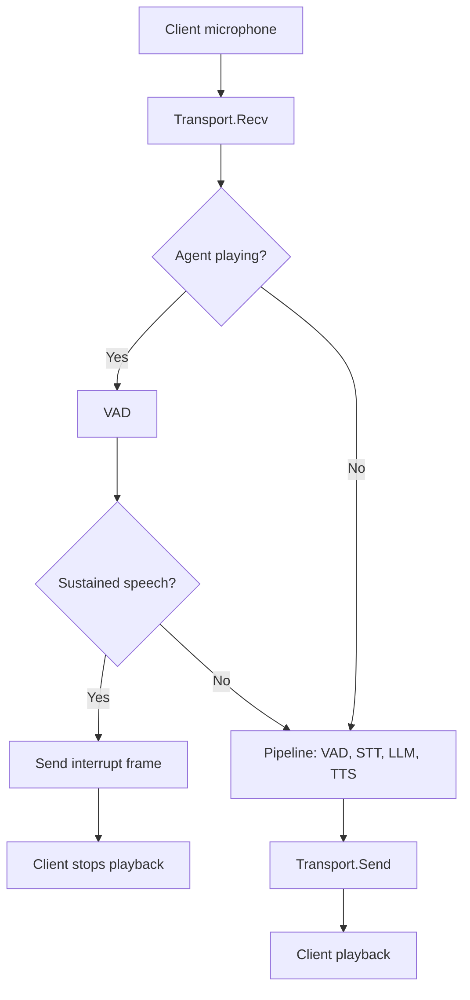

Contact center voice agents that play out entire responses without allowing interruption frustrate callers. Users expect the turn-taking of human dialogue: they interrupt when they already know the answer, correct a misunderstanding mid-sentence, or signal urgency. Without barge-in, callers wait through irrelevant speech, handle times go up, and satisfaction goes down.

Barge-in detection recognizes when the user starts speaking during agent playback, stops the playback, and returns to listening. The hard part is telling a genuine interruption apart from false triggers: background noise, acoustic echo of the agent's own voice, or a brief "uh-huh" that is not a turn change. A VAD that fires on every speech onset interrupts too often, so the decision needs a few extra rules on top of it.

## Solution Architecture



In Beluga's cascading pipeline (`voice.NewPipeline`), the pipeline pulls incoming frames from `Transport.Recv`, runs them through VAD, STT, LLM, and TTS, and writes the results with `Transport.Send`. The audio is played on the client after `Send` returns, so the pipeline keeps reading microphone input while the agent's voice plays. Barge-in detection therefore fits naturally in a transport wrapper:

- `Send` records how long the agent's audio will play.
- `Recv` checks each incoming audio frame while playback is active, and on a sustained speech onset sends a `voice.SignalInterrupt` control frame to the client.

Two separate stages keep the tuning independent. The VAD optimizes for recall, so it catches every potential onset. The barge-in rules (sustained speech, a confidence floor) optimize for precision and filter false triggers.

## Implementation

### VAD for Speech Onset

Use a VAD with a moderate threshold. Speed matters during playback, and the barge-in rules below filter brief noises:

```go
import (
	"github.com/lookatitude/beluga-ai/v2/voice"
	"github.com/lookatitude/beluga-ai/v2/voice/vad/providers/silero"
)

func newOnsetVAD() (voice.ActivityDetector, error) {
	return silero.New(silero.Config{Threshold: 0.5, SampleRate: 16000})
}
```

The `silero` provider currently uses an energy-based approximation of Silero's speech probability rather than the ONNX model. See [Sensitivity Tuning](/docs/guides/capabilities/voice/sensitivity-tuning) for how to choose between `energy`, `webrtc`, and `silero`, and how to calibrate thresholds per environment.

### Barge-In Transport Wrapper

The wrapper implements `voice.Transport`, so it can be passed to `voice.WithTransport` in place of the real transport. It requires the agent audio to be 16-bit PCM, because it estimates playback duration from the byte count. The `cartesia` provider returns raw 16-bit PCM; `elevenlabs` returns MP3, so with MP3 output have the client report when playback ends instead.

```go
import (
	"context"
	"iter"
	"sync"
	"time"

	"github.com/lookatitude/beluga-ai/v2/voice"
)

// BargeInTransport wraps a voice.Transport and interrupts client playback
// when the user speaks over the agent.
type BargeInTransport struct {
	inner      voice.Transport
	vad        voice.ActivityDetector
	sampleRate int
	// MinSpeech is how long speech must be sustained during playback before
	// it counts as barge-in. Filters coughs, clicks, and short backchannels.
	MinSpeech time.Duration
	// MinConfidence ignores weak detections, such as residual echo.
	MinConfidence float64
	// OnBargeIn is called after the interrupt frame is sent (optional).
	OnBargeIn func(ctx context.Context)

	mu           sync.Mutex
	playingUntil time.Time
	speechRun    time.Duration
}

var _ voice.Transport = (*BargeInTransport)(nil)

// NewBargeInTransport returns a wrapper with defaults suited to telephony.
func NewBargeInTransport(inner voice.Transport, vad voice.ActivityDetector, sampleRate int) *BargeInTransport {
	return &BargeInTransport{
		inner:         inner,
		vad:           vad,
		sampleRate:    sampleRate,
		MinSpeech:     150 * time.Millisecond,
		MinConfidence: 0.5,
	}
}

func (t *BargeInTransport) frameDuration(audio []byte) time.Duration {
	return time.Duration(len(audio)/2) * time.Second / time.Duration(t.sampleRate)
}

// Send forwards the frame and extends the playback window for agent audio.
func (t *BargeInTransport) Send(ctx context.Context, frame voice.Frame) error {
	if err := t.inner.Send(ctx, frame); err != nil {
		return err
	}
	if frame.Type == voice.FrameAudio {
		t.mu.Lock()
		start := time.Now()
		if t.playingUntil.After(start) {
			start = t.playingUntil // audio queues behind what is already playing
		}
		t.playingUntil = start.Add(t.frameDuration(frame.Data))
		t.mu.Unlock()
	}
	return nil
}

// Recv forwards incoming frames and checks for barge-in during playback.
func (t *BargeInTransport) Recv(ctx context.Context) iter.Seq2[voice.Frame, error] {
	return func(yield func(voice.Frame, error) bool) {
		for frame, err := range t.inner.Recv(ctx) {
			if err == nil && frame.Type == voice.FrameAudio {
				if bargeErr := t.checkBargeIn(ctx, frame.Data); bargeErr != nil {
					yield(voice.Frame{}, bargeErr)
					return
				}
			}
			if !yield(frame, err) {
				return
			}
		}
	}
}

func (t *BargeInTransport) checkBargeIn(ctx context.Context, audio []byte) error {
	t.mu.Lock()
	playing := time.Now().Before(t.playingUntil)
	if !playing {
		t.speechRun = 0
	}
	t.mu.Unlock()
	if !playing {
		return nil
	}

	res, err := t.vad.DetectActivity(ctx, audio)
	if err != nil {
		return err
	}

	t.mu.Lock()
	if res.IsSpeech && res.Confidence >= t.MinConfidence {
		t.speechRun += t.frameDuration(audio)
	} else {
		t.speechRun = 0
	}
	triggered := t.speechRun >= t.MinSpeech
	if triggered {
		t.playingUntil, t.speechRun = time.Time{}, 0
	}
	t.mu.Unlock()

	if !triggered {
		return nil
	}
	// Tell the client to stop playback and drop any queued agent audio.
	if err := t.inner.Send(ctx, voice.NewControlFrame(voice.SignalInterrupt)); err != nil {
		return err
	}
	if t.OnBargeIn != nil {
		t.OnBargeIn(ctx)
	}
	return nil
}

// Close closes the underlying transport.
func (t *BargeInTransport) Close() error { return t.inner.Close() }
```

With `transport.NewWebSocketTransport`, control frames are sent as JSON text messages that carry the frame type and `metadata.signal`. Your client stops its audio player and clears its buffer when it receives `{"type":"control","metadata":{"signal":"interrupt"}}`.

### Wiring It Into the Pipeline

```go
import (
	"context"

	"github.com/lookatitude/beluga-ai/v2/voice"
	"github.com/lookatitude/beluga-ai/v2/voice/transport"
)

func runWithBargeIn(ctx context.Context, url string, stt, llm, tts voice.FrameProcessor) error {
	ws, err := transport.NewWebSocketTransport(ctx, url, transport.WithWSSampleRate(16000))
	if err != nil {
		return err
	}
	defer ws.Close()

	onset, err := newOnsetVAD()
	if err != nil {
		return err
	}
	pipelineVAD, err := newOnsetVAD() // separate instance: detectors keep per-stream state
	if err != nil {
		return err
	}

	sess := voice.NewSession("call-123")
	bargeIn := NewBargeInTransport(ws, onset, 16000)
	bargeIn.OnBargeIn = func(ctx context.Context) {
		// Record the interruption on the session, for example for analytics.
		sess.Metadata["last_barge_in"] = true
	}

	pipe := voice.NewPipeline(
		voice.WithTransport(bargeIn),
		voice.WithVAD(pipelineVAD),
		voice.WithSTT(stt),
		voice.WithLLM(llm),
		voice.WithTTS(tts),
		voice.WithSession(sess),
	)
	return pipe.Run(ctx)
}
```

After a barge-in, the user's speech continues through the pipeline's own VAD and STT as a normal turn. Text the LLM stage already produced for the interrupted response may still be synthesized and sent. The client should drop agent audio it receives after an interrupt until the next response starts, or you can add a stage that discards it.

For speech-to-speech engines, sending `voice.NewControlFrame(voice.SignalInterrupt)` into `s2s.AsFrameProcessor` calls the provider session's `Interrupt` method, which cancels the in-progress response on the server side.

## Deployment Considerations

- **`MinSpeech`**: 100-200 ms keeps barge-in responsive. Raise it if coughs or short backchannels ("uh-huh") interrupt the agent.
- **Echo cancellation**: without acoustic echo cancellation (AEC) on the client, the agent's own voice reaches the microphone and triggers false barge-ins. Enable AEC in the browser or phone client early. `MinConfidence` only partly compensates.
- **Per-agent tuning**: agents with long responses benefit from more sensitive settings, and agents that read critical information (account numbers, confirmations) may want stricter ones.
- **Graceful truncation**: some agent replies will be cut off. That is expected; consider recording what the agent had said so far in the turn history.
- **Observability**: track barge-in events, latency from speech onset to playback stop, and the false-positive rate (interruptions followed by no transcript).

## Lessons from Tuning

- Separating "speech started" (VAD) from "this is a real interruption" (barge-in rules) makes each easier to tune.
- Short sustained-speech windows keep the agent responsive without excessive false triggers, once echo cancellation is in place.
- Measure in the real environment: thresholds that work on a headset rarely work on a speakerphone.

## Related Resources

- [Sensitivity Tuning](/docs/guides/capabilities/voice/sensitivity-tuning) for VAD thresholds and duration rules
- [Sentence-Boundary Turn Detection](/docs/guides/capabilities/voice/sentence-boundary) for end-of-turn rules
- [Voice Sessions Overview](/docs/guides/capabilities/voice/voice-sessions-overview) for session and pipeline design
