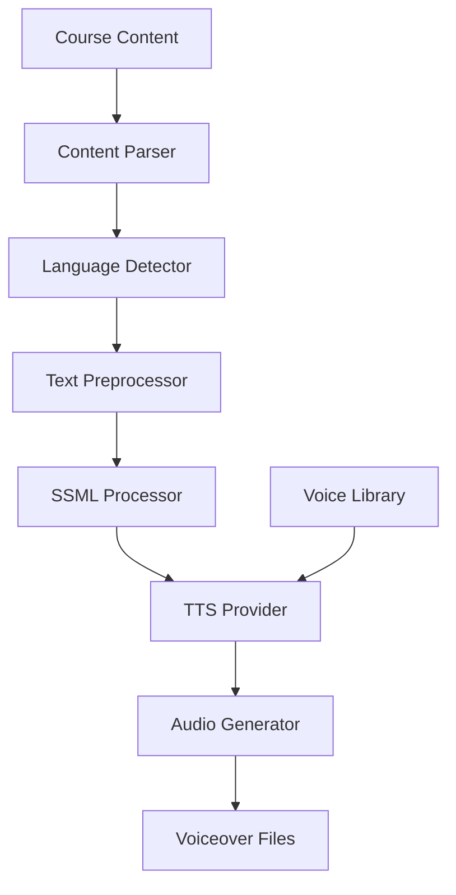

E-learning platforms serving global audiences face three compounding constraints: high voiceover production costs ($500-800 per course per language), long turnaround times (2-3 weeks per recording cycle), and limited language support (typically 3-4 languages). These constraints interact — adding a new language multiplies both cost and time, creating a scaling bottleneck that limits student reach to a fraction of the potential audience.

The production pipeline itself is the problem. Human voiceover requires voice talent scheduling, studio booking, recording, editing, and quality review — for every language, for every course update. When course content changes, the entire recording pipeline restarts.

With Beluga AI's TTS engines, voiceovers can be generated in batch for every language your TTS provider supports. The key is treating voiceover generation as a batch data processing problem rather than a creative production workflow.

## Solution Architecture



Course content is parsed into sections, preprocessed with SSML markup for pronunciation accuracy, and synthesized using language-appropriate voices. Batch processing generates voiceovers for multiple courses and languages in parallel.

The pipeline is structured as a linear flow (parse, detect language, preprocess, apply SSML, synthesize) because each stage has a single clear dependency on the previous stage's output. SSML preprocessing helps with educational content — technical terms, acronyms, and proper nouns often need explicit pronunciation guidance. Beluga passes text to the provider unchanged, so SSML only works with providers whose API interprets it; see [SSML Tuning](/docs/guides/capabilities/voice/ssml-tuning).

## Implementation

### Multi-Language TTS Setup

The generator wraps a single TTS engine instance and selects voices per language. This example uses the `lmnt` provider, which honors `tts.WithSpeed`; any registered provider works the same way, but speed and format options are only applied by providers that support them. Using a single engine with per-request voice selection (via functional options) avoids the overhead of maintaining separate engine instances for each language. The `selectVoice` function maps language codes to appropriate voices, providing a centralized place to manage voice assignments across all supported languages.

```go
package voiceover

import (
    "context"
    "fmt"
    "os"

    "github.com/lookatitude/beluga-ai/v2/voice/tts"

    _ "github.com/lookatitude/beluga-ai/v2/voice/tts/providers/lmnt"
)

// VoiceoverGenerator generates localized voiceovers for course content.
type VoiceoverGenerator struct {
    engine tts.TTS
}

func NewVoiceoverGenerator() (*VoiceoverGenerator, error) {
    engine, err := tts.New("lmnt", tts.Config{
        Extra: map[string]any{"api_key": os.Getenv("LMNT_API_KEY")},
    })
    if err != nil {
        return nil, fmt.Errorf("create tts engine: %w", err)
    }

    return &VoiceoverGenerator{engine: engine}, nil
}

func (g *VoiceoverGenerator) GenerateVoiceover(ctx context.Context, text string, language string) ([]byte, error) {
    audio, err := g.engine.Synthesize(ctx, text,
        tts.WithVoice(selectVoice(language)),
        tts.WithSpeed(0.95), // Slightly slower for educational content
    )
    if err != nil {
        return nil, fmt.Errorf("synthesize %s: %w", language, err)
    }

    return audio, nil
}

// selectVoice maps a language code to a voice ID from your provider's voice
// library. Replace the IDs with voices you have chosen for each language.
func selectVoice(language string) string {
    voices := map[string]string{
        "en": "lily",
        "es": "your-spanish-voice-id",
        "fr": "your-french-voice-id",
        "de": "your-german-voice-id",
    }

    if voice, ok := voices[language]; ok {
        return voice
    }
    return "lily" // default
}
```

### Batch Processing

Batch processing generates voiceovers for all sections across all languages concurrently. Add `"errors"` and `"sync"` to the imports above for this method. The implementation uses a semaphore pattern (buffered channel) to limit concurrency to 10 simultaneous TTS calls, staying within provider rate limits while maximizing throughput. A mutex protects the shared results and errors slices since goroutines append to them concurrently. Failures are collected and returned with `errors.Join`, so one failed section does not silently disappear from the batch.

```go
func (g *VoiceoverGenerator) GenerateBatch(ctx context.Context, sections []CourseSection, languages []string) ([]Voiceover, error) {
    var (
        results []Voiceover
        errs    []error
        mu      sync.Mutex
        wg      sync.WaitGroup
    )

    sem := make(chan struct{}, 10) // Limit concurrency

    for _, section := range sections {
        for _, lang := range languages {
            wg.Add(1)
            go func(s CourseSection, l string) {
                defer wg.Done()
                select {
                case sem <- struct{}{}:
                case <-ctx.Done():
                    return
                }
                defer func() { <-sem }()

                audio, err := g.GenerateVoiceover(ctx, s.Text, l)

                mu.Lock()
                defer mu.Unlock()
                if err != nil {
                    errs = append(errs, fmt.Errorf("section %s: %w", s.ID, err))
                    return
                }
                results = append(results, Voiceover{SectionID: s.ID, Language: l, Audio: audio})
            }(section, lang)
        }
    }

    wg.Wait()
    if err := ctx.Err(); err != nil {
        return results, err
    }
    return results, errors.Join(errs...) // partial results plus every failure
}

type CourseSection struct {
    ID   string
    Text string
    Type string // lecture, quiz, summary
}

type Voiceover struct {
    SectionID string
    Language  string
    Audio     []byte
}
```

## Deployment Considerations

- **SSML processing**: Use SSML markup for accurate pronunciation of technical terms and proper nouns
- **Voice library**: Build a per-language voice library with consistent voice choices across courses
- **Batch concurrency**: Limit concurrent TTS calls to stay within provider rate limits
- **Quality review**: Spot-check generated voiceovers for pronunciation accuracy before publishing
- **Cost management**: Track per-language generation costs and optimize batch sizes
- **Caching**: Cache generated audio segments to avoid regeneration when content does not change

## Lessons Learned

- **SSML is critical**: Educational terminology requires explicit pronunciation guidance for accuracy
- **Voice selection matters**: Language-appropriate, consistent voices significantly impact learning quality
- **Parallel batch processing**: Sequential processing was too slow; concurrent generation reduced turnaround by 90%+

## Related Resources

- [Interactive Audiobooks](/docs/guides/interactive-audiobooks/) for dynamic TTS with character voices
- [Voice AI Applications](/docs/guides/voice-applications/) for voice pipeline architecture
