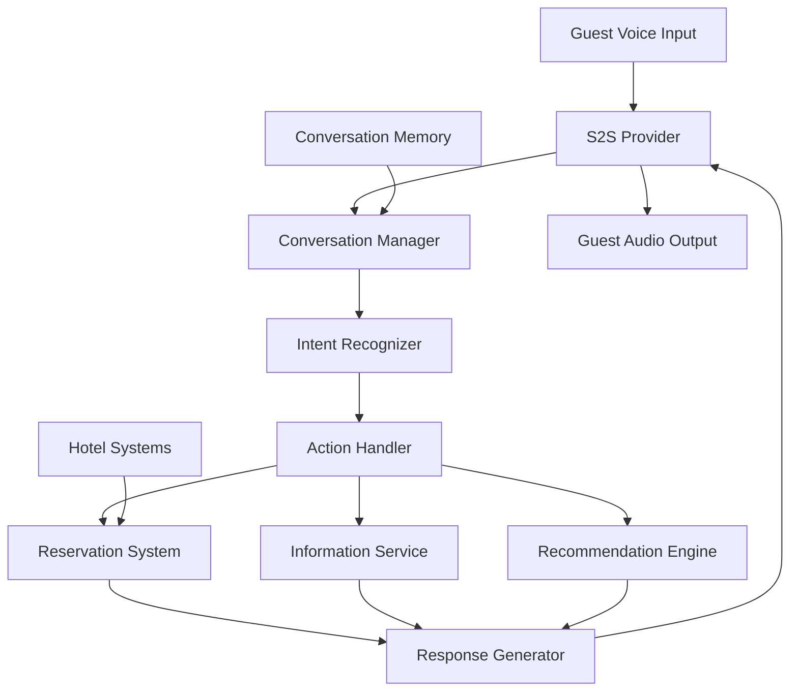

Luxury hotel chains spend $50K+ per month per hotel on human concierge services with limited availability (business hours only) and long wait times during peak demand. Guest satisfaction drops sharply when concierge wait times exceed 3 minutes, but staffing for peak demand means significant idle time during off-peak hours. The core business problem is that concierge labor costs scale linearly with availability, while guest demand is highly variable.

An AI concierge using speech-to-speech (S2S) provides 24/7 natural voice interactions, handles reservations and guest inquiries, and scales to unlimited concurrent guests with sub-2-second response times. S2S is chosen over separate STT+TTS because hospitality interactions demand natural, conversational pacing — guests expect the same responsiveness from a voice AI as from a human at the front desk.

## Solution Architecture



The concierge uses Beluga AI's S2S provider for real-time speech-to-speech. Tool functions connect to hotel systems for reservations, information lookup, and recommendations. Conversation memory maintains context across multi-turn interactions.

The tool-based integration approach is deliberate: rather than training a custom model on hotel-specific knowledge, the system gives the S2S model access to hotel systems through well-defined tool functions. This means hotel information stays in the source systems (PMS, reservation database, knowledge base) and is always current — no retraining needed when hours change or new amenities are added.

## Implementation

### Concierge Setup

The concierge is built by creating an S2S session with tool definitions for hotel operations. Beluga AI's `tool.NewFuncTool` creates type-safe tools from Go functions, generating the JSON schema from the `json`, `description`, `enum`, and `required` struct tags. The event loop ranges over `session.Recv(ctx)` and handles audio output (play to the guest), tool calls (execute against hotel systems and return the result with `SendToolResult`), and transcripts (log for quality assurance). Guest audio is sent into the session with `session.SendAudio` from your transport code.

```go
package concierge

import (
	"context"
	"encoding/json"
	"fmt"
	"io"
	"log"
	"os"

	"github.com/lookatitude/beluga-ai/v2/schema"
	"github.com/lookatitude/beluga-ai/v2/tool"
	"github.com/lookatitude/beluga-ai/v2/voice/s2s"

	_ "github.com/lookatitude/beluga-ai/v2/voice/s2s/providers/openai"
)

// BookingSystem and InfoService are your hotel back-office integrations.
type BookingSystem interface {
	Reserve(ctx context.Context, in BookingInput) (string, error)
}

type InfoService interface {
	Lookup(ctx context.Context, topic string) (string, error)
}

type BookingInput struct {
	Type   string `json:"type" description:"Kind of reservation" enum:"restaurant,spa,activity" required:"true"`
	Date   string `json:"date" description:"Reservation date (YYYY-MM-DD)" required:"true"`
	Time   string `json:"time" description:"Reservation time (HH:MM)" required:"true"`
	Guests int    `json:"guests" description:"Number of guests"`
	Name   string `json:"name" description:"Guest name"`
}

type InfoInput struct {
	Topic string `json:"topic" description:"Topic to look up (pool hours, restaurant menu, etc.)" required:"true"`
}

func startConcierge(ctx context.Context, guestID string, bookings BookingSystem, info InfoService, speaker io.Writer) error {
	bookingTool := tool.NewFuncTool[BookingInput](
		"make_reservation",
		"Make a restaurant, spa, or activity reservation for the guest",
		func(ctx context.Context, input BookingInput) (*tool.Result, error) {
			confirmation, err := bookings.Reserve(ctx, input)
			if err != nil {
				return tool.ErrorResult(err), nil
			}
			return tool.TextResult(fmt.Sprintf("Reservation confirmed: %s", confirmation)), nil
		},
	)

	infoTool := tool.NewFuncTool[InfoInput](
		"hotel_info",
		"Look up hotel information (hours, amenities, directions)",
		func(ctx context.Context, input InfoInput) (*tool.Result, error) {
			text, err := info.Lookup(ctx, input.Topic)
			if err != nil {
				return tool.ErrorResult(err), nil
			}
			return tool.TextResult(text), nil
		},
	)
	tools := map[string]tool.Tool{bookingTool.Name(): bookingTool, infoTool.Name(): infoTool}

	engine, err := s2s.New("openai", s2s.Config{
		Extra: map[string]any{"api_key": os.Getenv("OPENAI_API_KEY")},
	})
	if err != nil {
		return fmt.Errorf("create s2s engine: %w", err)
	}

	session, err := engine.Start(ctx,
		s2s.WithVoice("alloy"),
		s2s.WithInstructions("You are a luxury hotel concierge. Be warm, professional, "+
			"and helpful. Use the guest's name when known. You can make reservations "+
			"and look up hotel information."),
		s2s.WithTools([]schema.ToolDefinition{
			tool.ToDefinition(bookingTool),
			tool.ToDefinition(infoTool),
		}),
	)
	if err != nil {
		return fmt.Errorf("start session: %w", err)
	}
	defer session.Close()

	// Guest audio is sent from your transport with session.SendAudio(ctx, pcm).
	for event, err := range session.Recv(ctx) {
		if err != nil {
			return fmt.Errorf("session: %w", err)
		}
		switch event.Type {
		case s2s.EventAudioOutput:
			if _, err := speaker.Write(event.Audio); err != nil {
				return fmt.Errorf("play audio: %w", err)
			}
		case s2s.EventToolCall:
			result := runToolCall(ctx, tools, *event.ToolCall)
			if err := session.SendToolResult(ctx, result); err != nil {
				return fmt.Errorf("send tool result: %w", err)
			}
		case s2s.EventTranscript:
			log.Printf("guest %s: %s", guestID, event.Text)
		case s2s.EventError:
			log.Printf("provider error: %v", event.Error)
		}
	}
	return nil
}

// runToolCall executes a tool call from the model and converts the result
// into the schema.ToolResult the session expects.
func runToolCall(ctx context.Context, tools map[string]tool.Tool, call schema.ToolCall) schema.ToolResult {
	t, ok := tools[call.Name]
	if !ok {
		return schema.ToolResult{CallID: call.ID, IsError: true,
			Content: []schema.ContentPart{schema.TextPart{Text: "unknown tool " + call.Name}}}
	}
	var input map[string]any
	if err := json.Unmarshal([]byte(call.Arguments), &input); err != nil {
		return schema.ToolResult{CallID: call.ID, IsError: true,
			Content: []schema.ContentPart{schema.TextPart{Text: "invalid arguments: " + err.Error()}}}
	}
	res, err := t.Execute(ctx, input)
	if err != nil {
		return schema.ToolResult{CallID: call.ID, IsError: true,
			Content: []schema.ContentPart{schema.TextPart{Text: err.Error()}}}
	}
	return schema.ToolResult{CallID: call.ID, Content: res.Content, IsError: res.IsError}
}
```

## Deployment Considerations

- **Low latency**: S2S providers deliver sub-2-second response times for natural conversations
- **System integration**: Connect tool functions to hotel PMS, reservation systems, and knowledge bases
- **Conversation memory**: Use persistent state to maintain context across guest interactions
- **Multi-language**: Configure S2S instructions for each supported language
- **Failover**: Wrap session start in your own retry or circuit-breaker logic (see the `resilience` package); fall back to text-based chat if voice fails
- **Observability**: Track conversation quality, tool usage, and guest satisfaction with OpenTelemetry

## Lessons Learned

- **S2S for real-time interaction**: Speech-to-speech provides the most responsive and natural guest experience
- **Persistent conversation state**: Implement state management early; in-memory state causes issues on reconnection
- **Domain-specific tools**: Hotel-specific tool functions improve accuracy over generic intent models

## Related Resources

- [Bilingual Conversation Tutor](/docs/guides/bilingual-tutor/) for S2S language learning patterns
- [Conversational AI Assistant](/docs/guides/conversational-ai/) for adding memory to voice agents
- [Voice AI Applications](/docs/guides/voice-applications/) for voice pipeline architecture
