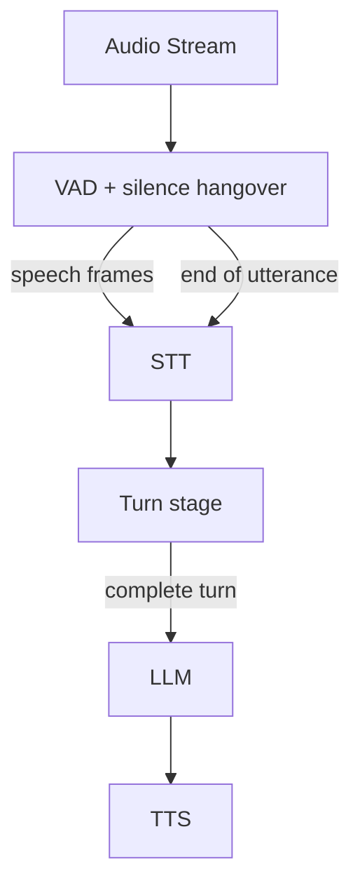

Voice AI vendors face a critical challenge: the delay between when a user stops speaking and when the system decides to respond. This "endpointing" decision directly impacts perceived responsiveness — every 100ms of unnecessary waiting adds to the user's sense of lag. Fixed silence windows (800ms) feel sluggish, while shorter windows cause premature interruptions that cut off users mid-thought. The fundamental tension is between responsiveness (respond quickly) and accuracy (wait long enough to be sure the user is done).

Low-latency turn prediction keeps that decision fast by combining a short silence window with content signals, so the agent can reply quickly when the user has clearly finished and wait when they have not. Beluga's voice pipeline gives you the building blocks: the VAD stage emits a `voice.SignalEndOfUtterance` control frame when speech ends, and any `voice.FrameProcessor` placed after STT can decide whether that end of utterance is also the end of the turn. Beluga does not ship a turn-detection package; the strategies below are small pieces of application code that plug into the pipeline.

## Solution Architecture



The VAD decides when speech stops, after a configurable silence. STT turns speech into transcript fragments. The turn stage buffers fragments and decides, on each end-of-utterance signal, whether to forward the turn to the LLM. Two knobs set latency: the silence window in the VAD, and how much evidence the turn stage needs.

Keeping the silence measurement in the VAD and the turn decision after STT means the turn logic can be swapped (rules for a model) without changing the VAD configuration.

## Implementation

### Heuristic Turn Detection with a Short Silence Window

Start with rules: they need no model, add no latency, and are tuned through configuration. The [Sentence-Boundary Turn Detection](/docs/guides/capabilities/voice/sentence-boundary) guide defines the three pieces used here: `TurnDetector` (sentence-end, length, and silence rules), `newHangoverVAD` (reports end of speech only after a minimum silence), and `turnStage` (buffers transcripts until a turn is complete). For low latency, shorten the silence window and rely on the sentence-end rule to avoid cutting users off:

```go
import (
	"time"

	"github.com/lookatitude/beluga-ai/v2/voice"
)

func lowLatencyTurnRules() TurnDetector {
	return TurnDetector{
		MinSilence:         280 * time.Millisecond, // starting point; tune per corpus
		MinTurnLength:      8,                      // characters
		MaxTurnLength:      4000,                   // guard against very long turns
		SentenceEndMarkers: ".!?",
	}
}

// buildTurnStages returns the VAD and STT stages for the pipeline.
func buildTurnStages(base voice.ActivityDetector, stt voice.FrameProcessor) (voice.ActivityDetector, voice.FrameProcessor) {
	rules := lowLatencyTurnRules()
	vad := newHangoverVAD(base, 16000, rules.MinSilence)
	return vad, voice.Chain(stt, turnStage(rules))
}
```

Pass the results to `voice.WithVAD` and `voice.WithSTT` when you build the pipeline with `voice.NewPipeline`.

### Model-Based Prediction for Production

Rules cannot tell "I want to fly to..." (pause) from a finished request, so short silence windows still cause some premature replies. A model that scores whether the transcript is complete fixes most of these, at the cost of an inference call per end of utterance. [ML-Based Turn Prediction](/docs/guides/capabilities/voice/ml-turn-prediction) shows a `TurnPredictor` interface with an LLM-based implementation and an adapter for your own model, plus a `predictedTurnStage` that replaces `turnStage`:

```go
	vad := newHangoverVAD(base, 16000, 250*time.Millisecond)
	sttStage := voice.Chain(sttProcessor, predictedTurnStage(predictor, 0.45))
```

The model's latency adds directly to response time, so measure it and set a client timeout. A dedicated small model is usually faster than an LLM call.

## Tuning Guide

| Parameter | Starting value | Effect | Guidance |
|-----------|----------------|--------|----------|
| Silence window (`MinSilence`) | 250-300ms | How long silence lasts before an end of utterance | Lower = faster replies, more premature turn ends |
| Predictor threshold | 0.45 | Model confidence required to end the turn | Higher = fewer premature replies, more latency |
| `MinTurnLength` | 8 | Minimum transcript length before a turn can end | Prevents very short spurious turns |
| `MaxTurnLength` | 4000 | Maximum transcript length | Forces a turn end on very long input |
| `SentenceEndMarkers` | `.!?` | Punctuation that signals a complete sentence | Language-specific; set per language |

## Deployment Considerations

- **Start with rules**: deploy the heuristic first, then add a model once you have logs and latency targets
- **Shadow testing**: run the model alongside the rules and log both decisions before switching
- **Per-language tuning**: set sentence-end markers and thresholds per language
- **Environment-specific**: treat the silence window and threshold as per-environment configuration (quiet vs. noisy)
- **Observability**: record the time from end of speech to turn decision, and the rate of premature and late turn ends, from day one

## Lessons Learned

- Measuring silence once, in the VAD, avoids extra buffering in the turn logic.
- Config-driven rules allow quick per-environment iteration before any model work.
- Validate a model in shadow mode before it decides real turns.

## Related Resources

- [Barge-In Detection](/docs/guides/capabilities/voice/barge-in-detection) for interruption handling
- [Voice Sessions Overview](/docs/guides/capabilities/voice/voice-sessions-overview) for session and pipeline design
- [Voice AI Applications](/docs/guides/capabilities/voice/voice-applications) for voice pipeline architecture
