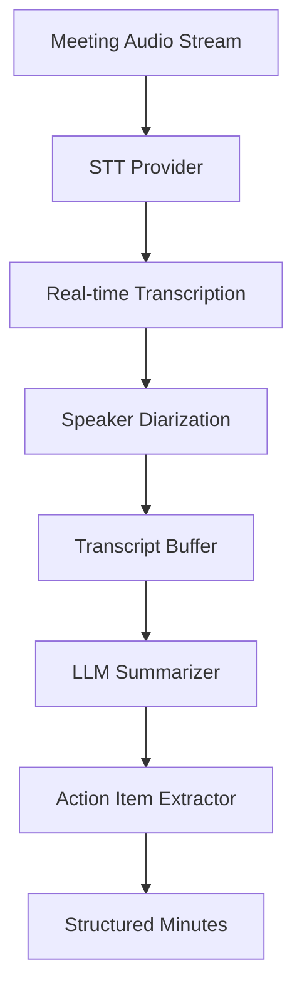

Manual meeting minutes take 1-2 hours to create, miss 20-30% of key points, and have 4-6 hour delays before sharing. The person taking notes must simultaneously listen, decide what matters, and write — a cognitive multitasking problem that inevitably drops information. Critical decisions, action item assignments, and dissenting opinions are the most likely casualties because they require contextual judgment to capture accurately.

The delay compounds the problem: by the time minutes circulate, participants have already moved on, and corrections require re-engaging everyone's attention. Incorrect or missing action items lead to dropped work and accountability gaps.

An automated system using Beluga AI's streaming STT and LLM-based summarization produces structured minutes as soon as the meeting ends.

## Solution Architecture



The STT provider transcribes meeting audio in real time. The transcript buffer accumulates segments, and at meeting end (or at intervals), the LLM summarizer generates structured minutes with key discussion points, decisions, and action items.

The pipeline is split into two distinct phases — transcription and summarization — rather than attempting real-time summarization of partial transcripts. This separation exists because LLM summarization quality degrades significantly on fragmented input. Complete transcript segments with speaker attribution produce dramatically better structured output than incremental updates. The buffered approach also means the STT and LLM components can be optimized independently: STT for latency and accuracy, LLM for output structure and completeness.

## Implementation

### Real-Time Transcription

The transcription function consumes a streaming audio source (`iter.Seq2[[]byte, error]`) and produces a complete transcript. Deepgram is used here; `stt.WithDiarization(true)` asks it to identify speakers. Note that `stt.TranscriptEvent` does not carry speaker labels, so attribution (who said what) needs a separate step, such as the `voice/diarization` package described in [Multi-Speaker Segmentation](/docs/guides/capabilities/voice/multi-speaker-segmentation), or per-participant audio tracks from your meeting platform. The `IsFinal` flag filters out interim results, ensuring only confirmed transcriptions enter the buffer.

```go
package main

import (
    "context"
    "fmt"
    "iter"
    "os"
    "strings"

    "github.com/lookatitude/beluga-ai/v2/config"
    "github.com/lookatitude/beluga-ai/v2/llm"
    "github.com/lookatitude/beluga-ai/v2/schema"
    "github.com/lookatitude/beluga-ai/v2/voice/stt"

    _ "github.com/lookatitude/beluga-ai/v2/llm/providers/openai"
    _ "github.com/lookatitude/beluga-ai/v2/voice/stt/providers/deepgram"
)

func transcribeMeeting(ctx context.Context, audioStream iter.Seq2[[]byte, error]) (string, error) {
    engine, err := stt.New("deepgram", stt.Config{
        Model: "nova-2",
        Extra: map[string]any{"api_key": os.Getenv("DEEPGRAM_API_KEY")},
    })
    if err != nil {
        return "", fmt.Errorf("create stt engine: %w", err)
    }

    transcripts := engine.TranscribeStream(ctx, audioStream,
        stt.WithLanguage("en"),
        stt.WithPunctuation(true),
        stt.WithDiarization(true),
    )

    var fullTranscript strings.Builder
    for event, err := range transcripts {
        if err != nil {
            return "", fmt.Errorf("transcription error: %w", err)
        }

        if event.IsFinal {
            fullTranscript.WriteString(event.Text + "\n")
            fmt.Printf("[%s] %s\n", event.Timestamp, event.Text)
        }
    }

    return fullTranscript.String(), nil
}
```

### Meeting Minutes Generation

The summarization step sends the complete transcript to an LLM with a structured prompt that explicitly requests attendees, key discussion points, decisions, and action items with owners. This structured prompting is critical — without explicit output guidance, the LLM tends to produce narrative summaries that are harder to act on than itemized lists.

```go
func generateMinutes(ctx context.Context, transcript string) (string, error) {
    model, err := llm.New("openai", config.ProviderConfig{
        APIKey: os.Getenv("OPENAI_API_KEY"),
        Model:  "gpt-4o",
    })
    if err != nil {
        return "", fmt.Errorf("create model: %w", err)
    }

    msgs := []schema.Message{
        schema.NewSystemMessage("Generate structured meeting minutes from this transcript. " +
            "Include: attendees, key discussion points, decisions made, and action items with owners."),
        schema.NewHumanMessage(transcript),
    }

    resp, err := model.Generate(ctx, msgs)
    if err != nil {
        return "", fmt.Errorf("generate: %w", err)
    }

    return resp.Text(), nil
}
```

### Full Pipeline

```go
func processMeeting(ctx context.Context, audioStream iter.Seq2[[]byte, error]) error {
    transcript, err := transcribeMeeting(ctx, audioStream)
    if err != nil {
        return fmt.Errorf("transcription: %w", err)
    }

    minutes, err := generateMinutes(ctx, transcript)
    if err != nil {
        return fmt.Errorf("generate minutes: %w", err)
    }

    fmt.Println(minutes)
    return nil
}
```

## Deployment Considerations

- **Streaming STT**: Use streaming transcription for real-time display during the meeting
- **Speaker attribution**: Attribute statements to speakers with per-participant audio tracks or a diarization step
- **Transcript buffering**: Buffer transcripts before summarization to improve minute quality
- **Multiple languages**: Configure STT language per meeting for global teams
- **Parallel tracks**: For multi-speaker meetings, process audio in parallel tracks per speaker
- **Observability**: Track transcription accuracy, summarization quality, and end-to-end latency

## Lessons Learned

- **Speaker attribution early**: Speaker-agnostic transcripts are significantly less useful for minutes
- **Buffering improves quality**: Processing complete transcript segments produces better summaries than immediate processing
- **LLM summarization is critical**: Prompt engineering for structured output (attendees, decisions, action items) drives quality

## Related Resources

- [Industrial Control](/docs/guides/industrial-control/) for STT in noisy environments
- [Multi-Speaker Segmentation](/docs/guides/multi-speaker-segmentation/) for speaker diarization patterns
- [Enterprise RAG Knowledge Base](/docs/guides/enterprise-rag/) for document summarization
