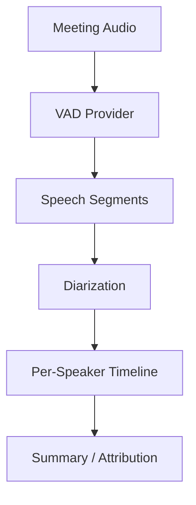

Meeting assistant products need to identify who spoke when for accurate attribution and summaries. Without speaker attribution, a transcript is a flat stream of text with no indication of who said what — useless for generating actionable minutes ("John agreed to handle the API migration by Friday"). Single-speaker VAD detects speech vs. silence but cannot distinguish between speakers; it only answers "is someone talking?" not "who is talking?"

Combining Beluga AI's VAD for segment boundaries with a diarization layer for speaker labels gives meeting systems a per-speaker timeline. The two-stage approach (VAD, then diarization) is deliberate: VAD is computationally cheap and runs on every audio frame, while diarization (speaker embeddings plus clustering) is more expensive and should run only on detected speech segments. This separation avoids spending diarization compute on silence.

Beluga's `voice/diarization` package defines the interfaces (`Diarizer`, `SpeakerTracker`), a registry, and two built-in implementations: `EnergyDiarizer` (registered as `"energy"`) and `InMemorySpeakerTracker`. The energy diarizer is a baseline for testing. It assigns speaker labels by loudness band, not by voice identity, so it cannot tell two people speaking at similar volume apart. Real speaker attribution needs a `Diarizer` backed by a speaker-embedding model or a diarization service, which you implement and register yourself.

## Solution Architecture



VAD processes audio and produces speech vs. non-speech boundaries. The application converts these into contiguous segments with start/end times. A diarization layer assigns speaker IDs to each segment using embeddings and clustering. The resulting per-speaker timeline feeds downstream summarization and analytics.

The pipeline flows in one direction: raw audio to segments to speaker labels to timeline. Each stage produces well-defined output that the next stage consumes, making it straightforward to test each component in isolation and to swap implementations (e.g., a different embedding model for diarization) without affecting upstream or downstream stages.

## Implementation

### VAD Segment Extraction

The segment extractor runs a Beluga VAD over a stream of 16-bit PCM frames and turns its frame-level speech decisions into contiguous segments with start and end times. It keeps the audio of each segment so the diarizer can analyze it. A short pause inside speech does not end a segment; use the debounce wrapper from [Sensitivity Tuning](/docs/guides/capabilities/voice/sensitivity-tuning#step-2-add-minimum-speech-and-silence-durations) to set how long a pause must be. Keep its minimum speech duration short (about 150 ms) to capture brief interjections like "yes" and "agreed", which matter for attribution.

```go
package meeting

import (
	"context"
	"iter"
	"time"

	"github.com/lookatitude/beluga-ai/v2/voice"
)

const sampleRate = 16000

// Segment is a contiguous speech region.
type Segment struct {
	Start time.Duration
	End   time.Duration
	Audio []byte // 16-bit PCM for the segment
}

func frameDuration(frame []byte) time.Duration {
	return time.Duration(len(frame)/2) * time.Second / sampleRate
}

// extractSegments splits an audio stream into speech segments using vad.
func extractSegments(ctx context.Context, vad voice.ActivityDetector, audio iter.Seq2[[]byte, error]) ([]Segment, error) {
	var (
		segments []Segment
		current  *Segment
		offset   time.Duration
	)

	for frame, err := range audio {
		if err != nil {
			return nil, err
		}
		res, err := vad.DetectActivity(ctx, frame)
		if err != nil {
			return nil, err
		}

		switch {
		case res.IsSpeech && current == nil:
			current = &Segment{Start: offset}
			current.Audio = append(current.Audio, frame...)
		case res.IsSpeech:
			current.Audio = append(current.Audio, frame...)
		case current != nil:
			current.End = offset
			segments = append(segments, *current)
			current = nil
		}
		offset += frameDuration(frame)
	}

	if current != nil {
		current.End = offset
		segments = append(segments, *current)
	}
	return segments, nil
}
```

### Diarization

Each segment is passed to a `diarization.Diarizer`, which returns `SpeakerSegment` values with a speaker ID and times relative to the audio it was given. A `SpeakerTracker` maps the diarizer's labels to stable IDs across calls, so the same person keeps the same ID for the whole meeting.

```go
import (
	"context"
	"fmt"

	"github.com/lookatitude/beluga-ai/v2/voice/diarization"
)

// assignSpeakers diarizes each VAD segment and returns speaker segments on
// the meeting timeline.
func assignSpeakers(ctx context.Context, d diarization.Diarizer, tracker diarization.SpeakerTracker, segments []Segment) ([]diarization.SpeakerSegment, error) {
	var out []diarization.SpeakerSegment
	for _, seg := range segments {
		labeled, err := d.Diarize(ctx, seg.Audio,
			diarization.WithSampleRate(sampleRate),
			diarization.WithMaxSpeakers(6),
		)
		if err != nil {
			return nil, fmt.Errorf("diarize segment at %v: %w", seg.Start, err)
		}
		labeled, err = tracker.Track(ctx, labeled)
		if err != nil {
			return nil, fmt.Errorf("track speakers: %w", err)
		}
		for _, s := range labeled {
			s.Start += seg.Start // shift to meeting time
			s.End += seg.Start
			out = append(out, s)
		}
	}
	return out, nil
}

// newDiarizer returns the built-in energy baseline. Replace "energy" with the
// name of your own registered Diarizer for real speaker attribution.
func newDiarizer() (diarization.Diarizer, diarization.SpeakerTracker, error) {
	d, err := diarization.New("energy", diarization.Config{MaxSpeakers: 6, SampleRate: sampleRate})
	if err != nil {
		return nil, nil, err
	}
	return d, diarization.NewSpeakerTracker(), nil
}
```

To plug in a real model, implement the one-method interface and register it in `init()`:

```go
// embeddingDiarizer labels speakers with a speaker-embedding model or service.
type embeddingDiarizer struct{ /* model client, clustering state */ }

func (d *embeddingDiarizer) Diarize(ctx context.Context, audio []byte, opts ...diarization.DiarizeOption) ([]diarization.SpeakerSegment, error) {
	// 1. Split audio into short windows and compute a speaker embedding per window.
	// 2. Cluster embeddings (or compare with known speakers) to pick a label.
	// 3. Merge adjacent windows with the same label into SpeakerSegments.
	return nil, fmt.Errorf("not implemented")
}

func init() {
	diarization.Register("embedding", func(cfg diarization.Config) (diarization.Diarizer, error) {
		return &embeddingDiarizer{}, nil
	})
}
```

### Per-Speaker Timeline

```go
import (
	"sort"
	"time"

	"github.com/lookatitude/beluga-ai/v2/voice/diarization"
)

// SpeakerTimeline lists when one speaker spoke.
type SpeakerTimeline struct {
	Speaker  string
	Segments []TimeRange
	Total    time.Duration
}

type TimeRange struct {
	Start time.Duration
	End   time.Duration
}

func buildTimeline(segments []diarization.SpeakerSegment) []SpeakerTimeline {
	bySpeaker := make(map[string]*SpeakerTimeline)
	for _, seg := range segments {
		tl, ok := bySpeaker[seg.SpeakerID]
		if !ok {
			tl = &SpeakerTimeline{Speaker: seg.SpeakerID}
			bySpeaker[seg.SpeakerID] = tl
		}
		tl.Segments = append(tl.Segments, TimeRange{Start: seg.Start, End: seg.End})
		tl.Total += seg.Duration()
	}

	timelines := make([]SpeakerTimeline, 0, len(bySpeaker))
	for _, tl := range bySpeaker {
		timelines = append(timelines, *tl)
	}
	sort.Slice(timelines, func(i, j int) bool { return timelines[i].Speaker < timelines[j].Speaker })
	return timelines
}
```

## Deployment Considerations

- **Overlap handling**: Meetings frequently have overlapping speech; represent overlap as segments with multiple speakers or as separate overlapping segments
- **Speaker count estimation**: When possible, pass the expected number of speakers with `diarization.WithMaxSpeakers` to improve clustering
- **Real-time vs. offline**: Run the VAD on frames as they arrive; buffer segments before diarization for better accuracy
- **VAD tuning**: A short minimum speech duration captures brief interjections common in meetings
- **Observability**: Track segment count, diarization accuracy, and boundary precision

## Lessons Learned

- **Short MinSpeechDuration**: Capturing brief interjections improved attribution completeness
- **Separate VAD from diarization**: Clear separation allowed independent tuning and best-of-breed component selection

## Related Resources

- [Noise-Resistant VAD](/docs/guides/noise-resistant-vad/) for robust VAD in high-noise environments
- [Meeting Minutes](/docs/guides/meeting-minutes/) for downstream meeting summarization
- [Voice Sessions Overview](/docs/guides/voice-sessions-overview/) for session and pipeline patterns
