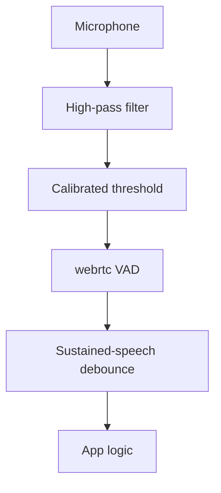

Field-service applications, factory floors, and vehicles need voice activity detection (VAD) that stays usable despite high background noise. A plain energy-based VAD, which only checks whether the signal is loud enough, cannot tell speech from mechanical noise, fan hum, or engine vibration at these levels. Every false trigger wastes downstream STT compute and can activate the wrong command in safety-critical environments.

Beluga's built-in detectors are signal-based: `energy` (RMS energy), `webrtc` (RMS energy plus zero-crossing rate), and `silero` (an energy-based approximation of Silero's speech probability; the ONNX model is not loaded yet). None of them is a trained noise-robust model. This guide shows how to get the most out of them in noise: pick the detector that rejects broadband noise, calibrate its threshold to the ambient noise floor, filter out low-frequency rumble, and require sustained speech before triggering.

## Solution Architecture



Audio is optionally filtered, then passed to a VAD whose threshold was set from a short calibration recording of the environment. A debounce stage requires speech to last a minimum time before it counts. Results feed application logic (wake word, push-to-talk, command trigger).

## Implementation

### Choose the Detector

The `webrtc` provider combines two signals. A frame counts as speech only if its RMS energy is above `threshold` and its zero-crossing rate (ZCR) is at or below `zcr_threshold`. Voiced speech has a low ZCR, while hiss, air flow, and many mechanical noises cross zero far more often. That makes it the best built-in choice for noisy environments.

| Provider | Signals                    | Behaviour in noise                                      |
|----------|----------------------------|---------------------------------------------------------|
| `webrtc` | RMS energy + zero-crossing rate | Rejects high-ZCR broadband noise; still fooled by loud low-frequency noise |
| `energy` | RMS energy                 | Triggers on any loud sound                              |
| `silero` | Normalized energy (0-1 scale) | Same limitation as `energy` today                    |

```go
package main

import (
	"context"
	"fmt"
	"log"

	"github.com/lookatitude/beluga-ai/v2/voice"
	_ "github.com/lookatitude/beluga-ai/v2/voice/vad/providers/webrtc"
)

func main() {
	ctx := context.Background()

	vad, err := voice.NewVAD("webrtc", map[string]any{
		"threshold":     2000.0, // RMS energy, 16-bit PCM scale
		"zcr_threshold": 0.08,   // max zero crossings per sample for speech
	})
	if err != nil {
		log.Fatalf("create VAD: %v", err)
	}

	frame := make([]byte, 640) // 20 ms at 16 kHz
	res, err := vad.DetectActivity(ctx, frame)
	if err != nil {
		log.Fatalf("detect: %v", err)
	}
	fmt.Printf("speech=%v confidence=%.2f\n", res.IsSpeech, res.Confidence)
}
```

`threshold` accepts a `float64` or an `int`. `zcr_threshold` must be a `float64`; the provider ignores other types for that key and uses the default (0.1).

### Calibrate the Threshold to the Noise Floor

Optimal thresholds vary by site, so measure instead of guessing. Record a few seconds of ambient noise when nobody is speaking, compute its RMS energy, and set the threshold a margin above it:

```go
import (
	"encoding/binary"
	"math"
)

// noiseFloor returns the RMS energy of 16-bit little-endian PCM audio.
func noiseFloor(pcm []byte) float64 {
	n := len(pcm) / 2
	if n == 0 {
		return 0
	}
	var sum float64
	for i := 0; i < n; i++ {
		s := float64(int16(binary.LittleEndian.Uint16(pcm[i*2:])))
		sum += s * s
	}
	return math.Sqrt(sum / float64(n))
}

// calibratedThreshold places the speech threshold a factor above the ambient noise.
// A factor of 2-3 (6-10 dB) is a reasonable starting point.
func calibratedThreshold(ambient []byte, factor float64) float64 {
	return math.Max(500, noiseFloor(ambient)*factor)
}
```

Use the result as the `threshold` value when you create the `webrtc` or `energy` detector. Repeat the calibration when the environment changes (shift change, machine start-up), and store per-site values.

### Filter and Debounce

Two wrappers around any `voice.ActivityDetector` further reduce false triggers:

- A **high-pass filter** removes low-frequency rumble (engines, HVAC) before detection. See the `highPassVAD` wrapper in [Custom VAD with Silero Models](/docs/guides/capabilities/voice/custom-silero-vad#step-4-preprocess-audio-before-detection).
- A **debounce** requires speech to last a minimum duration (for example 200 ms) before reporting `VADSpeechStart`, and silence to last a minimum duration before `VADSpeechEnd`. See the `debouncedVAD` wrapper in [Sensitivity Tuning](/docs/guides/capabilities/voice/sensitivity-tuning#step-2-add-minimum-speech-and-silence-durations).

Combined, with `base` from the calibrated `webrtc` detector above:

```go
	vad := newDebouncedVAD(newHighPassVAD(base, 16000, 150), 16000,
		200*time.Millisecond, // minimum speech
		600*time.Millisecond, // minimum silence
	)
```

### Real-Time Processing

In a cascading pipeline, pass the wrapped detector to `voice.WithVAD`. The pipeline runs it on every incoming audio frame, emits `voice.SignalStart` and `voice.SignalEndOfUtterance` control frames, and forwards only speech audio to STT. Outside a pipeline, run it over a frame stream yourself:

```go
import (
	"context"
	"iter"

	"github.com/lookatitude/beluga-ai/v2/voice"
)

// watch calls onSpeech for each speech onset in the audio stream.
func watch(ctx context.Context, vad voice.ActivityDetector, audio iter.Seq2[[]byte, error], onSpeech func()) error {
	speaking := false
	for frame, err := range audio {
		if err != nil {
			return err
		}
		res, err := vad.DetectActivity(ctx, frame)
		if err != nil {
			return err
		}
		if res.IsSpeech && !speaking {
			onSpeech() // command recognition, recording start, etc.
		}
		speaking = res.IsSpeech
	}
	return nil
}
```

## Tuning Guide

| Parameter                 | Range        | Effect                                           |
|---------------------------|--------------|--------------------------------------------------|
| `threshold` (`webrtc`)    | 2-3x noise floor RMS | Higher means fewer false positives and more missed speech |
| `zcr_threshold` (`webrtc`) | 0.05-0.15   | Lower rejects more hiss-like noise, but also some fricative-heavy speech |
| Minimum speech (debounce) | 100-300 ms   | Higher filters more noise bursts                 |
| Minimum silence (debounce) | 300-800 ms  | Higher merges closely spaced utterances          |
| High-pass cutoff          | 100-200 Hz   | Removes rumble without affecting the speech band |

## Deployment Considerations

- **Per-site profiles**: store threshold, ZCR, and duration settings per deployment (factory, vehicle, outdoor).
- **Calibration phase**: run the noise-floor calibration on first deployment and whenever the environment changes.
- **Microphone choice**: a close-talking or directional microphone improves the signal-to-noise ratio more than any threshold change.
- **Client-side noise suppression**: if audio comes from a browser or a telephony platform, enable its noise suppression before the audio reaches Beluga.
- **Observability**: log `Confidence` values and track false-trigger and missed-speech rates per site so you can tune from data.

## Related Resources

- [Multi-Speaker Segmentation](/docs/guides/capabilities/voice/multi-speaker-segmentation) for multi-speaker scenarios
- [Barge-In Detection](/docs/guides/capabilities/voice/barge-in-detection) for VAD in barge-in detection
- [Industrial Control](/docs/guides/capabilities/voice/industrial-control) for voice commands in noisy environments
