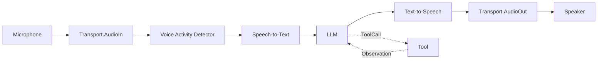
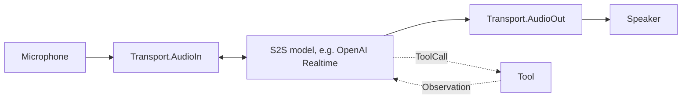
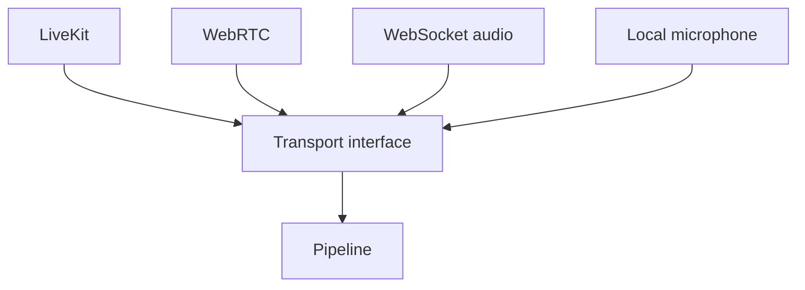
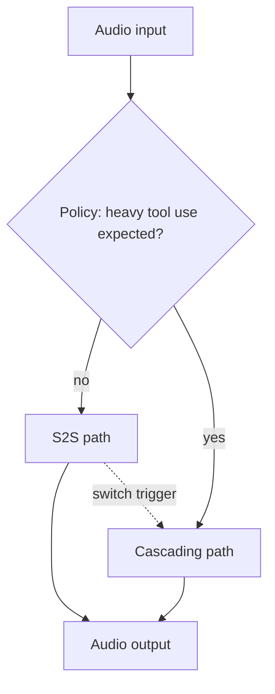

Voice AI transforms how users interact with agents — from typing and reading to speaking and listening. Building real-time voice applications requires careful architecture: audio data must flow through speech recognition, language model processing, and speech synthesis with minimal latency, while handling interruptions, silence detection, and transport-layer concerns like WebSocket connections and WebRTC media.

The `voice` package provides a **frame-based processing pipeline** for building these applications. The frame-based design, inspired by production systems like LiveKit Agents and Pipecat, treats audio as a stream of discrete frames flowing through linked processors. Each processor transforms an `iter.Seq2[Frame, error]` stream, and stages compose lazily: a frame flows through VAD, STT, LLM, and TTS as soon as it is pulled, without intermediate buffers. The target is sub-800ms end-to-end latency from user speech to agent response.

## Architecture

The cascading pipeline connects microphone audio through a chain of `FrameProcessor` stages, each transforming an `iter.Seq2[Frame, error]` stream.



Three pipeline modes offer different trade-offs between latency and capability:

| Mode | Flow | Latency | Use Case |
|------|------|---------|----------|
| **Cascading** | STT → LLM → TTS | ~800ms | Full control, tool use, any LLM |
| **S2S** | Audio → Model → Audio | ~300ms | Ultra-low latency, native audio models only |
| **Hybrid** | S2S default, cascade fallback | ~300-800ms | Low latency by default, cascade when tool use is heavy |

**Cascading** converts speech to text, processes with any LLM, and synthesizes audio — the most flexible mode that works with all providers and supports tool use. **S2S** (Speech-to-Speech) uses models with native audio input/output (like GPT-4o Realtime) for the lowest possible latency, but limits you to S2S-capable models. **Hybrid** combines them: S2S for conversational turns, and the cascade when a switch policy decides tool use has become heavy.

## Core Concepts

### Frames

Frames are the atomic data unit flowing through the pipeline. Rather than passing entire audio files or complete transcripts, the pipeline operates on small, typed frames that represent discrete chunks of data. This frame-based approach enables low-latency streaming: TTS can begin synthesizing audio before the LLM has finished generating its full response, because each text frame is processed independently as it arrives.

```go
// Frame types
voice.FrameAudio   // Raw audio data (PCM, opus)
voice.FrameText    // Text (transcript, LLM output)
voice.FrameControl // Control signals (start, stop, interrupt)
voice.FrameImage   // Image/video for multimodal

// Create frames
audioFrame := voice.NewAudioFrame(pcmData, 16000) // 16kHz audio
textFrame := voice.NewTextFrame("Hello, world!")
controlFrame := voice.NewControlFrame(voice.SignalInterrupt)
```

### Frame Processors

Every pipeline stage implements the `FrameProcessor` interface — a single method that takes an input frame stream and returns an output frame stream. This uniform interface means all processors — VAD, STT, LLM, TTS, custom logic — are interchangeable and composable. A processor can filter frames, transform them, or generate new frames.

```go
type FrameProcessor interface {
	Process(ctx context.Context, in iter.Seq2[Frame, error]) iter.Seq2[Frame, error]
}
```

Use `voice.FrameProcessorFunc` to adapt a function, or `voice.FrameLoop` for the common case of handling one frame at a time:

```go
// upper turns every text frame into upper case and passes other frames through.
upper := voice.FrameLoop(func(ctx context.Context, f voice.Frame) ([]voice.Frame, error) {
	if f.Type != voice.FrameText {
		return []voice.Frame{f}, nil
	}
	return []voice.Frame{voice.NewTextFrame(strings.ToUpper(f.Text()))}, nil
})
```

### Chaining Processors

The `Chain` function links processors into a pipeline where the output stream of one stage becomes the input stream of the next. This declarative composition makes it easy to reconfigure the pipeline — add a new processing stage, remove one, or swap implementations — without modifying other stages.

```go
pipeline := voice.Chain(
	vadProcessor,
	sttProcessor,
	llmProcessor,
	ttsProcessor,
)

// Process returns the output stream; ranging over it drives the pipeline.
for frame, err := range pipeline.Process(ctx, audioIn) {
	if err != nil {
		return err
	}
	// Send frame to the user.
}
```

`voice.NewPipeline` (below) does this wiring for you, reading from and writing to a transport.

## Speech-to-Text (STT)

STT converts audio input into text that an LLM can process. Beluga AI supports both batch transcription (for pre-recorded audio) and streaming transcription (for real-time applications where interim results are displayed as the user speaks). Every STT provider follows the registry pattern: import with a blank identifier, create with `stt.New()`, and use as a standalone engine or as a `FrameProcessor` in a pipeline.

```go
import (
	"github.com/lookatitude/beluga-ai/v2/voice/stt"
	_ "github.com/lookatitude/beluga-ai/v2/voice/stt/providers/deepgram"
)

engine, err := stt.New("deepgram", stt.Config{
	Model:      "nova-2",
	Encoding:   "linear16",
	SampleRate: 16000,
	Extra:      map[string]any{"api_key": os.Getenv("DEEPGRAM_API_KEY")},
})
if err != nil {
	log.Fatal(err)
}

// Batch transcription
text, err := engine.Transcribe(ctx, audioBytes,
	stt.WithLanguage("en-US"),
	stt.WithPunctuation(true),
)
if err != nil {
	log.Fatal(err)
}
fmt.Println(text)

// Streaming transcription
for event, err := range engine.TranscribeStream(ctx, audioStream) {
	if err != nil {
		log.Printf("STT error: %v", err)
		break
	}
	if event.IsFinal {
		fmt.Printf("Final: %s\n", event.Text)
	} else {
		fmt.Printf("Interim: %s\n", event.Text)
	}
}

// Streaming providers differ in whether they emit interim results; see
// Real-Time STT Streaming for details.

// Use as FrameProcessor in a pipeline
sttProcessor := stt.AsFrameProcessor(engine, stt.WithLanguage("en-US"))
```

### STT Providers

| Provider | Import Path | Features |
|----------|-------------|----------|
| Deepgram | `voice/stt/providers/deepgram` | Real-time, diarization |
| Whisper | `voice/stt/providers/whisper` | OpenAI, offline-capable |
| AssemblyAI | `voice/stt/providers/assemblyai` | Universal model |
| Gladia | `voice/stt/providers/gladia` | Multi-language |
| ElevenLabs | `voice/stt/providers/elevenlabs` | Scribe model |
| Groq | `voice/stt/providers/groq` | Fast Whisper |

## Text-to-Speech (TTS)

TTS converts the LLM's text response into audio that the user hears. For real-time applications, streaming synthesis is essential: it begins generating audio as soon as the first text tokens arrive from the LLM, rather than waiting for the complete response. This pipelining is what makes sub-second response times possible — TTS starts synthesizing while the LLM is still generating.

```go
import (
	"github.com/lookatitude/beluga-ai/v2/voice/tts"
	_ "github.com/lookatitude/beluga-ai/v2/voice/tts/providers/elevenlabs"
)

engine, err := tts.New("elevenlabs", tts.Config{
	Voice: "rachel",
	Model: "eleven_turbo_v2_5",
	Extra: map[string]any{"api_key": os.Getenv("ELEVENLABS_API_KEY")},
})
if err != nil {
	log.Fatal(err)
}

// Batch synthesis
audio, err := engine.Synthesize(ctx, "Hello, how can I help you today?",
	tts.WithVoice("rachel"),
)
if err != nil {
	log.Fatal(err)
}
player.Write(audio)

// Output format is provider-specific: ElevenLabs returns MP3, Cartesia raw PCM.
// tts.WithFormat is honored only by providers that expose a format option.

// Streaming synthesis (low latency)
for chunk, err := range engine.SynthesizeStream(ctx, textStream) {
	if err != nil {
		break
	}
	// Play audio chunk immediately (chunk is []byte)
	player.Write(chunk)
}

// Use as FrameProcessor; the sample rate is attached to the output audio frames
ttsProcessor := tts.AsFrameProcessor(engine, 24000, tts.WithVoice("rachel"))
```

### TTS Providers

| Provider | Import Path | Features |
|----------|-------------|----------|
| ElevenLabs | `voice/tts/providers/elevenlabs` | Voice cloning, low latency |
| Cartesia | `voice/tts/providers/cartesia` | Sonic model, fast |
| PlayHT | `voice/tts/providers/playht` | Voice cloning |
| LMNT | `voice/tts/providers/lmnt` | Real-time streaming |
| Fish | `voice/tts/providers/fish` | Open-source |
| Smallest | `voice/tts/providers/smallest` | Lightweight |
| Groq | `voice/tts/providers/groq` | Fast synthesis |

## Speech-to-speech mode

A single bidirectional model handles audio in, audio out, and tool calls. Lower latency than cascading (no STT/TTS round trips), more expensive per call. Tool calls arrive as `s2s.EventToolCall` session events.



## Speech-to-Speech (S2S)

Speech-to-Speech models process audio natively — they take audio input and produce audio output without an intermediate text stage. This eliminates the latency of separate STT and TTS steps, achieving response times as low as 300ms. The trade-off is that S2S models are available from fewer providers and give you less control over each stage. Tools are declared with `s2s.WithTools` (or `Config.Tools`); calls arrive as `s2s.EventToolCall` events and results go back with `SendToolResult`. Use S2S when latency is the primary concern.

```go
import (
	"github.com/lookatitude/beluga-ai/v2/voice/s2s"
	_ "github.com/lookatitude/beluga-ai/v2/voice/s2s/providers/openai"
)

engine, err := s2s.New("openai", s2s.Config{
	Model:        "gpt-4o-realtime-preview",
	Voice:        "alloy",
	SampleRate:   24000,
	Instructions: "You are a helpful voice assistant.",
	Extra:        map[string]any{"api_key": os.Getenv("OPENAI_API_KEY")},
})
if err != nil {
	log.Fatal(err)
}

// Start a bidirectional session
session, err := engine.Start(ctx)
if err != nil {
	log.Fatal(err)
}
defer session.Close()

// Send audio input using a context-cancellable goroutine
ctx, cancel := context.WithCancel(ctx)
defer cancel()

var wg sync.WaitGroup
wg.Add(1)
go func() {
	defer wg.Done()
	for {
		select {
		case <-ctx.Done():
			return
		case audioChunk, ok := <-audioInCh:
			if !ok {
				return
			}
			if err := session.SendAudio(ctx, audioChunk); err != nil {
				cancel()
				return
			}
		}
	}
}()

// Receive session events
for event, err := range session.Recv(ctx) {
	if err != nil {
		log.Printf("session error: %v", err)
		break
	}
	switch event.Type {
	case s2s.EventAudioOutput:
		speaker.Write(event.Audio) // your audio output, e.g. an io.Writer
	case s2s.EventTranscript:
		log.Printf("User said: %s", event.Text)
	case s2s.EventTurnEnd:
		log.Println("Turn complete")
	case s2s.EventError:
		log.Printf("Session error: %v", event.Error)
		cancel()
	}
}
wg.Wait()
```

### S2S Providers

| Provider | Import Path | Model |
|----------|-------------|-------|
| OpenAI | `voice/s2s/providers/openai` | GPT-4o Realtime |
| Amazon Nova | `voice/s2s/providers/nova` | Nova S2S |
| Google Gemini | `voice/s2s/providers/gemini` | Gemini Live |

## Voice Activity Detection (VAD)

VAD determines when the user is speaking and when they have stopped. This is critical for turn-taking: the pipeline should only process audio that contains speech, and it should detect end-of-utterance to trigger LLM processing. VAD also enables interruption handling — if the user starts speaking while the agent is responding, VAD detects the new speech and can signal the pipeline to stop the current output.

```go
import (
	"github.com/lookatitude/beluga-ai/v2/voice"
	_ "github.com/lookatitude/beluga-ai/v2/voice/vad/providers/silero"
)

vad, err := voice.NewVAD("silero", map[string]any{
	"threshold":   0.5, // speech probability threshold
	"sample_rate": 16000,
})
if err != nil {
	log.Fatal(err)
}
```

Minimum speech and silence durations are not built into the detectors; see [Sensitivity Tuning](/docs/guides/capabilities/voice/sensitivity-tuning) for a wrapper that adds them.

### VAD Providers

| Name | Package | Method |
|------|---------|--------|
| `energy` | `voice` (built in) | RMS energy threshold |
| `webrtc` | `voice/vad/providers/webrtc` | RMS energy plus zero-crossing rate |
| `silero` | `voice/vad/providers/silero` | Energy-based approximation of Silero's 0-1 speech probability. The `model_path` option is accepted, but the ONNX model is not loaded yet. |

## Transports

All transport providers implement the same interface: `Recv(ctx)` returns an `iter.Seq2[voice.Frame, error]` of incoming frames, `Send(ctx, frame)` writes an outgoing frame, and `Close()` shuts down the connection.



## Transport Layer

The transport layer handles the connection between the voice pipeline and the end user. Transports are pluggable, so the same pipeline logic works over any of them. Today the WebSocket transport is the working option. It dials a `ws://` or `wss://` URL, for example a media server or gateway that relays the browser's audio, and sends audio as binary messages and other frames as JSON. The LiveKit, Daily, and Pipecat providers are placeholders: they register and construct, but they do not connect yet. Their `Send` discards frames and their `Recv` yields nothing.

```go
import (
	"net/http"

	"github.com/lookatitude/beluga-ai/v2/voice/transport"
)

// WebSocket transport (built in): dials the URL and starts a read loop.
ws, err := transport.NewWebSocketTransport(ctx, "wss://media.example.com/session/123",
	transport.WithWSSampleRate(16000),
	transport.WithWSHeaders(http.Header{"Authorization": {"Bearer " + os.Getenv("MEDIA_TOKEN")}}),
)
if err != nil {
	log.Fatal(err)
}
defer ws.Close()
```

### Transport Providers

| Provider | Import Path | Type |
|----------|-------------|------|
| WebSocket | `voice/transport` (built in) | WebSocket client, working |
| LiveKit | `voice/transport/providers/livekit` | Placeholder, not yet functional |
| Daily | `voice/transport/providers/daily` | Placeholder, not yet functional |
| Pipecat | `voice/transport/providers/pipecat` | Placeholder, not yet functional |

## Hybrid mode

Start in S2S (low latency). If the conversation involves many tool calls, switch to the cascade (lower cost, better for tool-heavy workloads). The switch policy is a pluggable `voice.SwitchPolicy`.



## Hybrid Pipeline

The hybrid pipeline combines an S2S processor with a cascading `VoicePipeline`. It starts in S2S mode and switches to the cascade when its `SwitchPolicy` says so. `voice.OnToolOverload` switches after three tool calls; use `&voice.DefaultSwitchPolicy{ToolCallThreshold: n}` or a `voice.SwitchPolicyFunc` for other rules.

```go
hybrid := voice.NewHybridPipeline(
	voice.WithS2S(s2sProcessor),   // a voice.FrameProcessor that manages its own audio I/O
	voice.WithCascade(cascade),    // a *voice.VoicePipeline from voice.NewPipeline
	voice.WithSwitchPolicy(voice.OnToolOverload),
	voice.WithHybridSession(voice.NewSession("call-123")),
)

// Report tool usage so the policy can decide; the policy is evaluated when Run starts.
hybrid.UpdateState(toolCalls, turns)
if err := hybrid.Run(ctx); err != nil {
	log.Fatal(err)
}
```

Current limitations: the mode is chosen when `Run` is called, not mid-turn, and in S2S mode the hybrid pipeline passes the S2S processor an empty input stream. The S2S processor must therefore read and write audio itself, so wrapping an engine with `s2s.AsFrameProcessor`, which expects input frames, is not enough on its own. A session is required for S2S mode.

## Complete Voice Agent Example

The following example assembles a complete voice agent: Silero-calibrated VAD, Deepgram for STT, an OpenAI model for replies, Cartesia for TTS, and a WebSocket transport. Beluga has no built-in LLM stage for the voice pipeline, so the example defines one with `voice.FrameLoop`: it sends each transcript to the model and emits the reply as a text frame.

```go
package main

import (
	"context"
	"log"
	"os"
	"os/signal"

	"github.com/lookatitude/beluga-ai/v2/config"
	"github.com/lookatitude/beluga-ai/v2/llm"
	"github.com/lookatitude/beluga-ai/v2/schema"
	"github.com/lookatitude/beluga-ai/v2/voice"
	"github.com/lookatitude/beluga-ai/v2/voice/stt"
	"github.com/lookatitude/beluga-ai/v2/voice/transport"
	"github.com/lookatitude/beluga-ai/v2/voice/tts"

	_ "github.com/lookatitude/beluga-ai/v2/llm/providers/openai"
	_ "github.com/lookatitude/beluga-ai/v2/voice/stt/providers/deepgram"
	_ "github.com/lookatitude/beluga-ai/v2/voice/tts/providers/cartesia"
	_ "github.com/lookatitude/beluga-ai/v2/voice/vad/providers/silero"
)

const sampleRate = 16000

// llmStage turns each transcript text frame into a reply text frame.
func llmStage(model llm.ChatModel) voice.FrameProcessor {
	history := []schema.Message{schema.NewSystemMessage("You are a concise, friendly voice assistant.")}
	return voice.FrameLoop(func(ctx context.Context, f voice.Frame) ([]voice.Frame, error) {
		if f.Type != voice.FrameText {
			return []voice.Frame{f}, nil
		}
		history = append(history, schema.NewHumanMessage(f.Text()))
		resp, err := model.Generate(ctx, history)
		if err != nil {
			return nil, err
		}
		history = append(history, resp)
		return []voice.Frame{voice.NewTextFrame(resp.Text())}, nil
	})
}

func main() {
	ctx, stop := signal.NotifyContext(context.Background(), os.Interrupt)
	defer stop()

	vad, err := voice.NewVAD("silero", map[string]any{"threshold": 0.5, "sample_rate": sampleRate})
	if err != nil {
		log.Fatal(err)
	}

	sttEngine, err := stt.New("deepgram", stt.Config{
		Language:   "en-US",
		SampleRate: sampleRate,
		Encoding:   "linear16",
		Extra:      map[string]any{"api_key": os.Getenv("DEEPGRAM_API_KEY")},
	})
	if err != nil {
		log.Fatal(err)
	}

	// Cartesia returns raw 16-bit PCM at the requested sample rate.
	ttsEngine, err := tts.New("cartesia", tts.Config{
		Voice:      os.Getenv("CARTESIA_VOICE_ID"),
		SampleRate: sampleRate,
		Extra:      map[string]any{"api_key": os.Getenv("CARTESIA_API_KEY")},
	})
	if err != nil {
		log.Fatal(err)
	}

	model, err := llm.New("openai", config.ProviderConfig{
		APIKey: os.Getenv("OPENAI_API_KEY"),
		Model:  "gpt-4o",
	})
	if err != nil {
		log.Fatal(err)
	}

	ws, err := transport.NewWebSocketTransport(ctx, os.Getenv("VOICE_WS_URL"),
		transport.WithWSSampleRate(sampleRate))
	if err != nil {
		log.Fatal(err)
	}
	defer ws.Close()

	pipe := voice.NewPipeline(
		voice.WithTransport(ws),
		voice.WithVAD(vad),
		voice.WithSTT(stt.AsFrameProcessor(sttEngine)),
		voice.WithLLM(llmStage(model)),
		voice.WithTTS(tts.AsFrameProcessor(ttsEngine, sampleRate)),
		voice.WithSession(voice.NewSession("session-1")),
	)

	log.Println("voice agent connected")
	if err := pipe.Run(ctx); err != nil && ctx.Err() == nil {
		log.Fatal(err)
	}
}
```

The VAD forwards only speech frames to STT, and `stt.AsFrameProcessor` transcribes each frame as it arrives. For better accuracy on full utterances, buffer audio until end of utterance before transcribing; [Sentence-Boundary Turn Detection](/docs/guides/capabilities/voice/sentence-boundary) shows how to group transcripts into turns.

## Latency Budget

Real-time voice applications have strict latency requirements — users perceive delays beyond ~1 second as unnatural. The following budget allocates time across pipeline stages. When optimizing, focus on the stages with the largest budgets (STT, LLM TTFT, TTS TTFB) as they offer the most room for improvement. Choosing providers with low-latency modes and deploying in regions close to your users are the highest-impact optimizations.

| Stage | Target | Description |
|-------|--------|-------------|
| Transport | < 50ms | WebSocket/WebRTC hop |
| VAD | < 1ms | Speech detection |
| STT | < 200ms | Transcription |
| LLM TTFT | < 300ms | First token latency |
| TTS TTFB | < 200ms | First audio byte |
| Return | < 50ms | Transport return |
| **Total** | **< 800ms** | End-to-end |

## Next Steps

- [Building Your First Agent](/docs/guides/first-agent/) — Combine voice with agent logic
- [Tools & MCP](/docs/guides/tools-and-mcp/) — Give voice agents tool access
- [Monitoring & Observability](/docs/guides/observability/) — Track voice pipeline latency
- [Deploying to Production](/docs/guides/deployment/) — Deploy voice agents at scale
