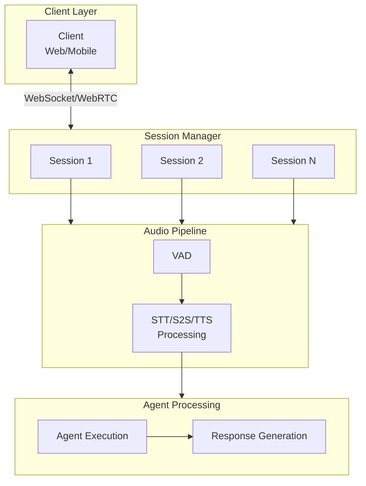

Voice agents have unique challenges compared to text-based AI: users notice delays above 200ms, connections drop on mobile networks, and each session consumes significant resources (audio buffers, STT/TTS engine instances, WebSocket connections). Unlike text chat where a dropped connection just means a missed message, a dropped voice connection means the conversation stops entirely — there is no way to asynchronously resume a real-time audio stream.

These constraints drive three architectural requirements: low-latency processing (every stage must be optimized for speed), session resilience (automatic reconnection with state preservation), and resource management (bounded concurrency to prevent overload). A well-implemented voice session system delivers responsive conversations, automatic recovery from failures, efficient resource usage, and clear debugging visibility. This guide covers the architecture and implementation patterns for production voice sessions in Beluga AI.

## Solution Architecture



### How It Works

1. **Client connects** via WebSocket or WebRTC with a session token
2. **Session Manager** creates or resumes a session, allocating resources
3. **Audio Pipeline** runs incoming audio through VAD, which marks speech start and end of utterance
4. **Voice Provider** transcribes audio (STT) or processes end-to-end (S2S)
5. **Agent** processes the transcript and generates a response
6. **Response** is converted to audio (TTS) and streamed back to client

## Implementation

### Session Manager

The session manager maintains a map of active sessions with concurrent access protection via `sync.RWMutex`. It enforces a hard limit on concurrent sessions to prevent resource exhaustion — voice sessions are significantly more resource-intensive than text sessions due to audio buffers and streaming connections. The `CleanupIdle` method garbage-collects sessions that have gone silent, preventing resource leaks from dropped connections that never received a proper close signal.

```go
package main

import (
    "context"
    "fmt"
    "sync"
    "time"
)

// SessionManager manages all active voice sessions.
type SessionManager struct {
    sessions map[string]*VoiceSession
    mu       sync.RWMutex
    maxConc  int
}

func NewSessionManager(maxConcurrent int) *SessionManager {
    return &SessionManager{
        sessions: make(map[string]*VoiceSession),
        maxConc:  maxConcurrent,
    }
}

func (m *SessionManager) CreateSession(ctx context.Context, sessionID string, userID string) (*VoiceSession, error) {
    m.mu.Lock()
    defer m.mu.Unlock()

    if len(m.sessions) >= m.maxConc {
        return nil, fmt.Errorf("max concurrent sessions reached: %d", m.maxConc)
    }

    if _, exists := m.sessions[sessionID]; exists {
        return nil, fmt.Errorf("session already exists: %s", sessionID)
    }

    session := &VoiceSession{
        ID:         sessionID,
        UserID:     userID,
        State:      "connected",
        StartTime:  time.Now(),
        LastActive: time.Now(),
    }

    m.sessions[sessionID] = session
    return session, nil
}

func (m *SessionManager) CleanupIdle(ctx context.Context, idleTimeout time.Duration) int {
    m.mu.Lock()
    defer m.mu.Unlock()

    now := time.Now()
    closed := 0

    for id, session := range m.sessions {
        if now.Sub(session.LastActive) > idleTimeout {
            delete(m.sessions, id)
            session.Close()
            closed++
        }
    }

    return closed
}
```

### Voice Session Processing

Each voice session tracks its state (connected, processing, listening, responding, disconnected) and conversation history. This application-level session wraps connection concerns; inside a pipeline, Beluga's own `voice.VoiceSession` (created with `voice.NewSession(id)` and passed with `voice.WithSession`) tracks the idle, listening, and speaking states and the `voice.Turn` history. State transitions are explicit — the session moves through well-defined states that determine how audio is routed. This state machine approach ensures that the system never tries to play TTS output while simultaneously processing STT input, which would cause echo and confusion.

```go
// VoiceSession represents an active voice conversation.
type VoiceSession struct {
    ID         string
    UserID     string
    State      string
    StartTime  time.Time
    LastActive time.Time
    History    []ConversationTurn
}

type ConversationTurn struct {
    UserText   string
    AgentText  string
    StartTime  time.Time
    Latency    time.Duration
}

func (s *VoiceSession) ProcessAudio(ctx context.Context, sttEngine stt.STT, audioData []byte) (string, error) {
    s.LastActive = time.Now()
    s.State = "processing"

    transcript, err := sttEngine.Transcribe(ctx, audioData,
        stt.WithLanguage("en"),
        stt.WithPunctuation(true),
    )
    if err != nil {
        return "", fmt.Errorf("transcription failed: %w", err)
    }

    s.State = "listening"
    return transcript, nil
}

func (s *VoiceSession) GenerateResponse(ctx context.Context, ttsEngine tts.TTS, text string) ([]byte, error) {
    s.State = "responding"

    audio, err := ttsEngine.Synthesize(ctx, text)
    if err != nil {
        return nil, fmt.Errorf("tts failed: %w", err)
    }

    s.State = "listening"
    return audio, nil
}

func (s *VoiceSession) Close() {
    s.State = "disconnected"
}
```

### Building a Full Pipeline

Inside each session, a cascading `voice.VoicePipeline` connects the transport, VAD, STT, your agent stage, and TTS. The VAD is an `ActivityDetector`, not a frame processor, so it is passed with `voice.WithVAD` rather than chained. `agentStage` is your LLM or agent wrapped as a `voice.FrameProcessor`, for example a `voice.FrameLoop` that calls `model.Generate` on each text frame.

```go
import (
    "context"
    "fmt"
    "os"

    "github.com/lookatitude/beluga-ai/v2/voice"
    "github.com/lookatitude/beluga-ai/v2/voice/stt"
    "github.com/lookatitude/beluga-ai/v2/voice/tts"

    _ "github.com/lookatitude/beluga-ai/v2/voice/stt/providers/deepgram"
    _ "github.com/lookatitude/beluga-ai/v2/voice/tts/providers/cartesia"
    _ "github.com/lookatitude/beluga-ai/v2/voice/vad/providers/silero"
)

func buildVoicePipeline(ctx context.Context, conn voice.Transport, agentStage voice.FrameProcessor, sess *voice.VoiceSession) (*voice.VoicePipeline, error) {
    vad, err := voice.NewVAD("silero", map[string]any{"threshold": 0.5, "sample_rate": 16000})
    if err != nil {
        return nil, fmt.Errorf("create vad: %w", err)
    }

    sttEngine, err := stt.New("deepgram", stt.Config{
        SampleRate: 16000,
        Encoding:   "linear16",
        Extra:      map[string]any{"api_key": os.Getenv("DEEPGRAM_API_KEY")},
    })
    if err != nil {
        return nil, fmt.Errorf("create stt: %w", err)
    }

    ttsEngine, err := tts.New("cartesia", tts.Config{
        Voice:      os.Getenv("CARTESIA_VOICE_ID"),
        SampleRate: 16000,
        Extra:      map[string]any{"api_key": os.Getenv("CARTESIA_API_KEY")},
    })
    if err != nil {
        return nil, fmt.Errorf("create tts: %w", err)
    }

    return voice.NewPipeline(
        voice.WithTransport(conn),
        voice.WithVAD(vad),
        voice.WithSTT(stt.AsFrameProcessor(sttEngine, stt.WithLanguage("en"))),
        voice.WithLLM(agentStage),
        voice.WithTTS(tts.AsFrameProcessor(ttsEngine, 16000)),
        voice.WithSession(sess),
    ), nil
}
```

Call `Run(ctx)` on the result; it blocks until the context is cancelled or the transport fails.

## Reconnection Handling

Voice sessions must survive network interruptions, especially on mobile networks where brief disconnections are common. The reconnection strategy uses exponential backoff with a 10-second cap to balance responsiveness (first retry is fast) with server protection (subsequent retries do not overwhelm the server during outages). State is preserved across reconnection attempts so the conversation resumes from where it left off. Beluga's WebSocket transport has no reconnect method; a closed transport stays closed. Reconnecting means dialing a new transport and running a new pipeline over it with the same session state.

```go
// HandleReconnect redials until it succeeds and returns the new transport.
// dial is typically a closure around transport.NewWebSocketTransport.
func (s *VoiceSession) HandleReconnect(ctx context.Context, dial func(context.Context) (voice.Transport, error), maxAttempts int, baseDelay time.Duration) (voice.Transport, error) {
    s.State = "reconnecting"

    var lastErr error
    for attempt := 1; attempt <= maxAttempts; attempt++ {
        delay := baseDelay * time.Duration(1<<uint(attempt-1))
        if delay > 10*time.Second {
            delay = 10 * time.Second
        }

        select {
        case <-ctx.Done():
            return nil, ctx.Err()
        case <-time.After(delay):
        }

        conn, err := dial(ctx)
        if err != nil {
            lastErr = err
            continue
        }

        s.State = "connected"
        s.LastActive = time.Now()
        return conn, nil
    }

    s.State = "error"
    return nil, fmt.Errorf("reconnection failed after %d attempts: %w", maxAttempts, lastErr)
}
```

## Observability

Track voice-specific metrics at every stage:

```go
import (
    "go.opentelemetry.io/otel"
    "go.opentelemetry.io/otel/attribute"
)

func recordTurnMetrics(ctx context.Context, sttLatency, agentLatency, ttsLatency, totalLatency time.Duration) {
    tracer := otel.Tracer("beluga.voice.session")
    _, span := tracer.Start(ctx, "voice.turn")
    defer span.End()

    span.SetAttributes(
        attribute.Float64("voice.stt_latency_ms", float64(sttLatency.Milliseconds())),
        attribute.Float64("voice.agent_latency_ms", float64(agentLatency.Milliseconds())),
        attribute.Float64("voice.tts_latency_ms", float64(ttsLatency.Milliseconds())),
        attribute.Float64("voice.e2e_latency_ms", float64(totalLatency.Milliseconds())),
    )
}
```

## Performance Targets

Set targets per stage and measure against them with the metrics above. These are reasonable starting points; actual numbers depend on your providers, regions, and network.

| Metric | Target |
|--------|--------|
| End-to-end turn latency | < 2s |
| STT latency | < 500ms |
| Agent latency | < 1s |
| TTS latency | < 500ms |
| Reconnection success rate | > 95% |
| Memory per session | < 50MB |

## Deployment Considerations

- **Transport choice**: Beluga's WebSocket transport is the working option today. The LiveKit, Daily, and Pipecat providers are placeholders that do not connect yet, so WebRTC needs a gateway that bridges to WebSocket
- **Session affinity**: Voice sessions are stateful; use sticky sessions at the load balancer
- **Resource limits**: Set hard limits on audio buffers and max session duration
- **S2S mode**: If your use case allows, S2S is simpler and lower latency than STT+TTS
- **Streaming TTS**: Send audio chunks as they are generated; do not wait for complete audio
- **Circuit breakers**: Aggressive reconnection can worsen overload; use circuit breakers

## Related Resources

- [Voice AI Applications](/docs/guides/capabilities/voice/voice-applications/) for complete voice pipeline patterns
- [Voice Forms](/docs/guides/capabilities/voice/voice-forms/) for multi-turn voice form collection
- [Production Agent Platform](/docs/guides/production/production-platform/) for deployment patterns
