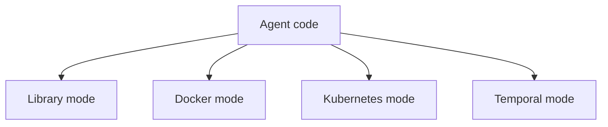
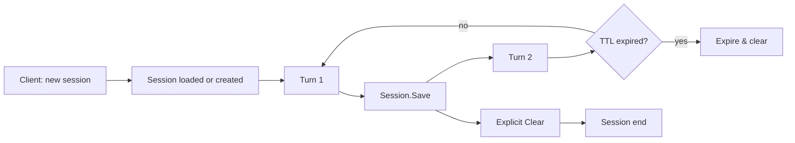
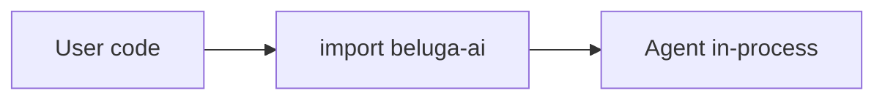
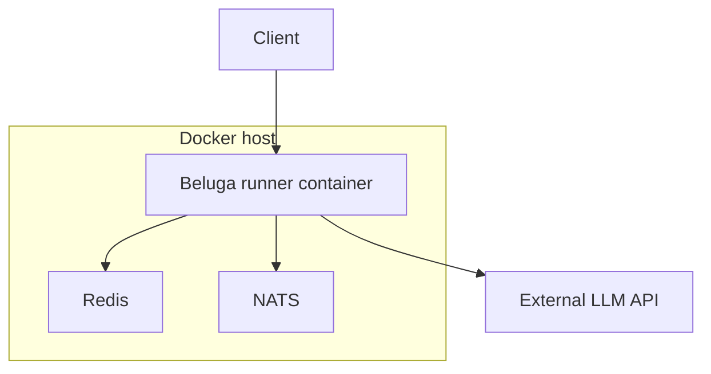
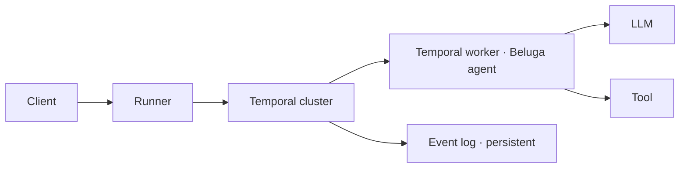
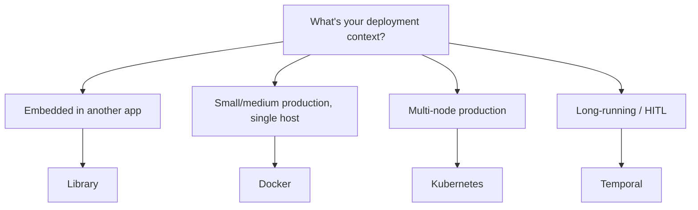

Deploy Beluga agents as production-grade HTTP services with built-in resilience, configuration hot-reload, multi-tenant support, and container-ready architecture. The deployment patterns described here separate your agent logic from the HTTP framework, resilience policies, and infrastructure concerns, so each layer can be changed independently.

The same agent code runs in all four deployment modes — the choice is operational, not architectural.



## HTTP Server Adapters

The `server` package provides the `ServerAdapter` interface that decouples agent logic from HTTP frameworks. This means the same agent works with `net/http`, Gin, Fiber, Echo, Chi, gRPC, or Connect without changing a single line of agent code. You choose the HTTP framework that matches your team's preferences and existing infrastructure, and the adapter handles the translation between HTTP requests and agent invocations.

This pattern follows the same design philosophy as the rest of Beluga: interfaces define the contract, implementations are swappable via the registry, and your application code depends only on the interface.

```go
type ServerAdapter interface {
	RegisterAgent(path string, a agent.Agent) error
	RegisterHandler(path string, handler http.Handler) error
	Serve(ctx context.Context, addr string) error
	Shutdown(ctx context.Context) error
}
```

### Basic REST API

The following example creates a complete HTTP service from an agent. The adapter automatically generates two endpoints for each registered agent: a synchronous invocation endpoint and a streaming endpoint using Server-Sent Events (SSE).

```go
import (
	"github.com/lookatitude/beluga-ai/v2/agent"
	"github.com/lookatitude/beluga-ai/v2/llm"
	"github.com/lookatitude/beluga-ai/v2/server"
	_ "github.com/lookatitude/beluga-ai/v2/llm/providers/openai"
)

func main() {
	ctx := context.Background()

	model, err := llm.New("openai", config.ProviderConfig{
		APIKey: os.Getenv("OPENAI_API_KEY"),
		Model:  "gpt-4o",
	})
	if err != nil {
		log.Fatal(err)
	}

	a := agent.New("assistant",
		agent.WithLLM(model),
		agent.WithPersona(agent.Persona{Role: "helpful assistant"}),
	)

	adapter := server.NewStdlibAdapter(server.Config{
		ReadTimeout:  10 * time.Second,
		WriteTimeout: 30 * time.Second,
		IdleTimeout:  120 * time.Second,
	})

	// Register agent endpoints
	err = adapter.RegisterAgent("/v1/chat", a)
	if err != nil {
		log.Fatal(err)
	}

	// Start server
	log.Println("Serving on :8080")
	if err := adapter.Serve(ctx, ":8080"); err != nil {
		log.Fatal(err)
	}
}
```

This creates two endpoints:
- `POST /v1/chat/invoke` — Synchronous invocation
- `POST /v1/chat/stream` — Server-Sent Events (SSE) streaming

### Framework Adapters

Each adapter follows the same `ServerAdapter` interface, so switching frameworks requires only changing the import and constructor call. The adapter handles framework-specific routing, middleware integration, and response writing.

| Adapter | Import Path | Framework |
|---------|-------------|-----------|
| `stdlib` | Built-in | `net/http` (default) |
| `gin` | `server/adapters/gin` | Gin |
| `fiber` | `server/adapters/fiber` | Fiber |
| `echo` | `server/adapters/echo` | Echo |
| `chi` | `server/adapters/chi` | Chi |
| `huma` | `server/adapters/huma` | Huma |
| `grpc` | `server/adapters/grpc` | gRPC |
| `connect` | `server/adapters/connect` | Connect-Go |

```go
import _ "github.com/lookatitude/beluga-ai/v2/server/adapters/gin"

adapter, err := server.New("gin", server.Config{
	ReadTimeout:  10 * time.Second,
	WriteTimeout: 30 * time.Second,
})
```

## Resilience Patterns

The `resilience` package provides production resilience primitives that protect your application from the failure modes common in AI services: provider outages, rate limiting, high tail latency, and traffic spikes. Each pattern addresses a specific failure mode. They are plain functions and types, so you compose them by wrapping your calls (or by writing a small `llm.Middleware`).

### Circuit Breaker

When a downstream service (like an LLM provider) is failing, continuing to send requests wastes resources and increases latency. The circuit breaker pattern monitors failure rates and "opens" the circuit after a threshold is reached, immediately failing subsequent requests instead of waiting for timeouts. After the reset timeout, the circuit enters a half-open state and lets a single probe request through. If it succeeds, the circuit closes and normal operation resumes; while open, `Execute` returns `resilience.ErrCircuitOpen` without calling your function.

```go
import "github.com/lookatitude/beluga-ai/v2/resilience"

// Open after 5 consecutive failures; probe again after 30s.
cb := resilience.NewCircuitBreaker(5, 30*time.Second)

result, err := cb.Execute(ctx, func(ctx context.Context) (any, error) {
	return model.Generate(ctx, msgs)
})
if errors.Is(err, resilience.ErrCircuitOpen) {
	// Fail fast: the provider is considered unhealthy.
}
if err != nil {
	return err
}
resp := result.(*schema.AIMessage)
```

### Retry with Backoff

Transient failures (network blips, temporary rate limits, provider-side errors) often resolve on their own within seconds. The retry pattern re-attempts failed operations with exponential backoff and jitter, which avoids thundering herd problems where all retries hit the provider simultaneously. The `IsRetryable` function from the `core` package ensures that only transient errors are retried; permanent failures (invalid API key, malformed request) fail immediately.

```go
policy := resilience.RetryPolicy{
	MaxAttempts:    3,
	InitialBackoff: 100 * time.Millisecond,
	MaxBackoff:     5 * time.Second,
	BackoffFactor:  2.0,
	Jitter:         true,
	// RetryableErrors left empty: core.IsRetryable decides.
}

text, err := resilience.Retry(ctx, policy, func(ctx context.Context) (string, error) {
	resp, err := model.Generate(ctx, msgs)
	if err != nil {
		return "", err
	}
	return resp.Text(), nil
})
```

### Hedge Requests

LLM providers occasionally exhibit high tail latency: most requests complete in under a second, but a small percentage take 10 seconds or more. The hedge pattern addresses this by sending a duplicate request after a delay. Whichever request completes first wins, and the slower one is canceled. This dramatically reduces P99 latency at the cost of slightly higher average request volume.

```go
call := func(m llm.ChatModel) func(context.Context) (string, error) {
	return func(ctx context.Context) (string, error) {
		resp, err := m.Generate(ctx, msgs)
		if err != nil {
			return "", err
		}
		return resp.Text(), nil
	}
}

// Start the secondary if the primary has not answered within 200ms.
text, err := resilience.Hedge(ctx, call(primary), call(secondary), 200*time.Millisecond)
if err != nil {
	return err
}
```

### Rate Limiting

Rate limiting protects downstream services from being overwhelmed by traffic spikes. This is especially important with LLM providers that enforce per-minute or per-second token limits, where exceeding the limit results in errors or temporary bans. `resilience.RateLimiter` uses token buckets for requests per minute (RPM) and tokens per minute (TPM), plus a concurrency cap.

```go
limiter := resilience.NewRateLimiter(resilience.ProviderLimits{
	RPM:           600, // requests per minute
	TPM:           200_000,
	MaxConcurrent: 20,
})

// Allow blocks until an RPM token and a concurrency slot are available.
if err := limiter.Allow(ctx); err != nil {
	return err // context canceled or deadline exceeded
}
defer limiter.Release()

resp, err := model.Generate(ctx, msgs)
if err != nil {
	return err
}
// Charge the tokens actually used against the TPM budget.
if err := limiter.ConsumeTokens(ctx, resp.Usage.TotalTokens); err != nil {
	return err
}
```

### Combining Resilience Patterns

The `resilience` package does not ship ready-made LLM middleware, so compose the primitives in a wrapper function. The order below is: rate limit check, then retry with backoff, then circuit breaker check, then the actual LLM call.

```go
func resilientGenerate(ctx context.Context, model llm.ChatModel, limiter *resilience.RateLimiter,
	cb *resilience.CircuitBreaker, msgs []schema.Message) (*schema.AIMessage, error) {
	if err := limiter.Allow(ctx); err != nil {
		return nil, err
	}
	defer limiter.Release()

	return resilience.Retry(ctx, resilience.DefaultRetryPolicy(), func(ctx context.Context) (*schema.AIMessage, error) {
		out, err := cb.Execute(ctx, func(ctx context.Context) (any, error) {
			return model.Generate(ctx, msgs)
		})
		if err != nil {
			return nil, err
		}
		return out.(*schema.AIMessage), nil
	})
}
```

To apply the limits directly to a model, `llm.ApplyMiddleware(model, llm.WithProviderLimits(llm.ProviderLimits{RPM: 600, TPM: 100000, MaxConcurrent: 20}))` wraps it. The middleware records each response's `Usage.TotalTokens` and stops admitting requests once the trailing-minute `TPM` budget is spent.

## Configuration Management

The `config` package loads JSON configuration files with `default`, `required`, `min` and `max` struct tags, merges environment-variable overrides with `config.MergeEnv`, and watches files for changes with `config.NewFileWatcher`. Environment variables override file values, following the twelve-factor app methodology. The watcher polls the file and invokes a callback with the new raw bytes when it changes, so you can re-parse and adjust at runtime without restarting the service.

```go
import "github.com/lookatitude/beluga-ai/v2/config"

type AppConfig struct {
	LLMProvider string `json:"llm_provider" default:"openai"`
	LLMModel    string `json:"llm_model" default:"gpt-4o"`
	APIKey      string `json:"api_key" required:"true"`
	Port        int    `json:"port" default:"8080"`
	MaxTokens   int    `json:"max_tokens" default:"4096"`
}

// Load from file (defaults applied, required fields validated)
cfg, err := config.Load[AppConfig]("config.json")
if err != nil {
	log.Fatal(err)
}
// Override from APP_LLM_PROVIDER, APP_API_KEY, APP_PORT, ...
if err := config.MergeEnv(&cfg, "APP"); err != nil {
	log.Fatal(err)
}

// Hot-reload: poll the file every 5s and re-parse on change
watcher := config.NewFileWatcher("config.json", 5*time.Second)
defer watcher.Close()
go func() {
	err := watcher.Watch(ctx, func(raw any) {
		var next AppConfig
		if err := json.Unmarshal(raw.([]byte), &next); err != nil {
			log.Printf("invalid config update: %v", err)
			return
		}
		log.Println("Configuration updated")
		// Reinitialize components with next
	})
	if err != nil && ctx.Err() == nil {
		log.Printf("config watcher stopped: %v", err)
	}
}()
```

## Docker Deployment

The multi-stage Dockerfile below produces a minimal container image with only the compiled binary and CA certificates. The `CGO_ENABLED=0` flag ensures a fully static binary that does not depend on system libraries, making it portable across Linux distributions.

### Dockerfile

```dockerfile
FROM golang:1.26-alpine AS builder
WORKDIR /app
COPY go.mod go.sum ./
RUN go mod download
COPY . .
RUN CGO_ENABLED=0 go build -o /agent ./cmd/agent

FROM alpine:3.20
RUN apk add --no-cache ca-certificates
COPY --from=builder /agent /agent
EXPOSE 8080
ENTRYPOINT ["/agent"]
```

### Docker Compose

This compose file sets up the agent alongside Redis (for memory/cache) and an OpenTelemetry Collector (for trace and metric export). The health check ensures that the container orchestrator restarts the agent if it becomes unresponsive.

```yaml
version: "3.9"
services:
  agent:
    build: .
    ports:
      - "8080:8080"
    environment:
      - OPENAI_API_KEY=${OPENAI_API_KEY}
      - PORT=8080
    healthcheck:
      test: ["CMD", "wget", "-q", "--spider", "http://localhost:8080/healthz"]
      interval: 10s
      timeout: 5s
      retries: 3

  redis:
    image: redis:7-alpine
    ports:
      - "6379:6379"

  otel-collector:
    image: otel/opentelemetry-collector:latest
    ports:
      - "4317:4317"  # gRPC
      - "4318:4318"  # HTTP
```

## Kubernetes Deployment

The Kubernetes manifests below deploy the agent with horizontal scaling, secrets management, resource limits, and health probes. The liveness probe detects process hangs, while the readiness probe ensures traffic is only routed to instances with healthy dependencies (LLM provider, vector store, cache).

```yaml
apiVersion: apps/v1
kind: Deployment
metadata:
  name: beluga-agent
spec:
  replicas: 3
  selector:
    matchLabels:
      app: beluga-agent
  template:
    metadata:
      labels:
        app: beluga-agent
    spec:
      containers:
        - name: agent
          image: myregistry/beluga-agent:latest
          ports:
            - containerPort: 8080
          env:
            - name: OPENAI_API_KEY
              valueFrom:
                secretKeyRef:
                  name: llm-secrets
                  key: openai-api-key
            - name: OTEL_EXPORTER_OTLP_ENDPOINT
              value: "http://otel-collector:4317"
          resources:
            requests:
              cpu: 100m
              memory: 128Mi
            limits:
              cpu: "1"
              memory: 512Mi
          livenessProbe:
            httpGet:
              path: /healthz
              port: 8080
            initialDelaySeconds: 5
            periodSeconds: 10
          readinessProbe:
            httpGet:
              path: /readyz
              port: 8080
            initialDelaySeconds: 5
            periodSeconds: 10
---
apiVersion: v1
kind: Service
metadata:
  name: beluga-agent
spec:
  selector:
    app: beluga-agent
  ports:
    - port: 80
      targetPort: 8080
  type: ClusterIP
```

## Multi-Tenant Setup

Multi-tenant deployments serve multiple customers from the same service instance. Beluga supports tenant isolation through context-based routing, where each request carries a tenant identifier that flows through the entire pipeline. This identifier can be used to select tenant-specific models, apply per-tenant rate limits, and isolate memory stores.

```go
import "github.com/lookatitude/beluga-ai/v2/core"

// Middleware to extract tenant from request
func tenantMiddleware(next http.Handler) http.Handler {
	return http.HandlerFunc(func(w http.ResponseWriter, r *http.Request) {
		tenantID := r.Header.Get("X-Tenant-ID")
		if tenantID == "" {
			http.Error(w, "missing tenant ID", http.StatusBadRequest)
			return
		}
		ctx := core.WithTenant(r.Context(), core.TenantID(tenantID))
		next.ServeHTTP(w, r.WithContext(ctx))
	})
}
```

## Graceful Shutdown

Production services must handle shutdown signals cleanly to avoid dropping in-flight requests or losing buffered telemetry data. The pattern below uses Go's `signal.NotifyContext` to create a context that cancels on SIGINT or SIGTERM, giving the server time to finish active requests before the process exits. The tracer shutdown flushes any buffered spans to the exporter.

```go
func main() {
	ctx, cancel := signal.NotifyContext(context.Background(), os.Interrupt, syscall.SIGTERM)
	defer cancel()

	// Initialize components...

	// Start server (blocks until context canceled)
	if err := adapter.Serve(ctx, ":8080"); err != nil {
		log.Printf("Server stopped: %v", err)
	}

	// Cleanup
	log.Println("Shutting down...")
	shutdownCtx, shutdownCancel := context.WithTimeout(context.Background(), 10*time.Second)
	defer shutdownCancel()

	tracerShutdown() // Flush pending traces
	log.Println("Shutdown complete")
}
```

## Sessions

A session holds conversation history, metadata, artifacts, and an optional TTL. Sessions are opaque to the agent — it sees messages, not the session object, which lets you swap `SessionService` implementations without changing agent code.



## Library mode

Import Beluga as a Go library. Agent runs in-process with no network and no session service (or an in-memory one).



Use for CLIs, desktop apps, embedded tools, and unit tests. Zero infrastructure.

## Docker mode

Wrap a `Runner` in a container, add Redis for sessions and NATS for the event bus, and compose them.



Use for single-tenant SaaS, internal tools, and small-to-medium production without a Kubernetes cluster.

## Kubernetes mode

Define an `Agent` custom resource. The Beluga operator reconciles it into a Deployment, Service, HPA, NetworkPolicy, and ServiceMonitor.

```mermaid
graph TD
  CR[Agent CRD] --> Op[Beluga Operator]
  Op --> Dep[Deployment]
  Op --> Svc[Service]
  Op --> HPA[HorizontalPodAutoscaler]
  Op --> NP[NetworkPolicy]
  Op --> SM[ServiceMonitor]
  Dep --> Pod1[Runner pod 1]
  Dep --> Pod2[Runner pod 2]
  Dep --> Pod3[Runner pod N]
  Pod1 --> Card[/.well-known/agent.json]
```

Use for multi-tenant or high-volume production with autoscaling needs.

## Temporal mode

The Runner hands the agent loop off to a Temporal workflow. Each activity (LLM call, tool execute) is recorded in Temporal's event log and survives process restarts.



Use for long-running or human-in-the-loop workflows. See [DOC-16 — Durable Workflows](https://github.com/lookatitude/beluga-ai/blob/main/docs/architecture/16-durable-workflows.md).

## Picking a mode



These modes are not mutually exclusive. A large deployment might run most agents in Kubernetes and a subset in Temporal for long-running research tasks — same agent code, different runners.

## Production Checklist

This checklist covers the essential configuration for a production Beluga deployment. Each item maps to patterns described in the guides linked below.

| Category | Item |
|----------|------|
| **Security** | API keys in environment variables or secrets manager |
| **Security** | Guard pipeline for input/output validation |
| **Security** | HITL policies for high-risk operations |
| **Resilience** | Circuit breakers on all external calls |
| **Resilience** | Retry with backoff for LLM calls |
| **Resilience** | Rate limiting per tenant |
| **Observability** | OpenTelemetry tracing enabled |
| **Observability** | Prometheus metrics exported |
| **Observability** | Health check endpoints exposed |
| **Observability** | Structured JSON logging with trace correlation |
| **Infrastructure** | Horizontal scaling via replicas |
| **Infrastructure** | Resource limits configured |
| **Infrastructure** | Graceful shutdown handling |

## Next Steps

- [Monitoring & Observability](/docs/guides/production/observability/) — Production monitoring setup with distributed tracing
- [Safety & Guards](/docs/guides/production/safety-and-guards/) — Production safety configuration and guard pipelines
- [Working with LLMs](/docs/guides/foundations/working-with-llms/) — Multi-provider resilience and fallback strategies
- [Memory System](/docs/guides/capabilities/memory/memory-system/) — Production memory backends with Redis and PostgreSQL
