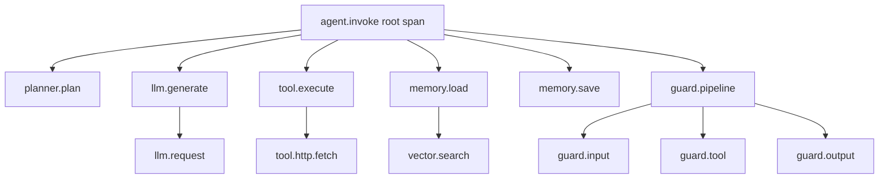

AI applications are harder to observe than traditional services because their behavior depends on probabilistic model outputs, context windows that change with each request, and external provider latency that varies significantly. The `o11y` package provides production-grade observability built on OpenTelemetry, using the GenAI semantic conventions that define a standard vocabulary for AI-specific telemetry.

Beluga uses OpenTelemetry because it is the industry-standard, vendor-neutral observability framework. All major backends (Jaeger, Grafana Tempo, Datadog, Honeycomb) understand OTel's trace, metric, and log formats, so you can switch backends without changing instrumentation code. The GenAI semantic conventions (`gen_ai.*` attributes) extend this with AI-specific metadata like model names, token counts, and operation types, enabling powerful queries such as "show me all calls to gpt-4o that took longer than 5 seconds" or "what is the average token cost per agent per hour."

## Setup

Initialize tracing and metrics at application startup. The shutdown function returned by `InitTracer` flushes any buffered spans before the process exits, ensuring that in-flight traces are not lost during shutdown.

```go
import (
	"github.com/lookatitude/beluga-ai/v2/o11y"
	"go.opentelemetry.io/otel/exporters/otlp/otlptrace/otlptracegrpc"
)

func main() {
	ctx := context.Background()

	// Set up OTLP exporter
	exporter, err := otlptracegrpc.New(ctx,
		otlptracegrpc.WithEndpoint("localhost:4317"),
		otlptracegrpc.WithInsecure(),
	)
	if err != nil {
		log.Fatal(err)
	}

	// Initialize tracer
	shutdown, err := o11y.InitTracer("my-ai-service",
		o11y.WithSpanExporter(exporter),
	)
	if err != nil {
		log.Fatal(err)
	}
	defer shutdown()

	// Initialize metrics
	if err := o11y.InitMeter("my-ai-service"); err != nil {
		log.Fatal(err)
	}

	// Your application code...
}
```

## Distributed Tracing



Distributed tracing captures the full lifecycle of a request as it flows through agents, LLM calls, tool executions, and guard validations. Each operation creates a span, and spans are linked through parent-child relationships to form a trace tree. This structure lets you see not just that a request failed, but exactly where in the pipeline it failed and what happened before the failure.

### Creating Spans

Use `o11y.StartSpan` to create spans with GenAI semantic attributes. These attributes provide structured metadata that backends can index and query, which is far more useful than unstructured log messages for diagnosing production issues.

```go
ctx, span := o11y.StartSpan(ctx, "llm.generate", o11y.Attrs{
	o11y.AttrOperationName: "chat",
	o11y.AttrRequestModel:  "gpt-4o",
	o11y.AttrSystem:         "openai",
	o11y.AttrAgentName:      "researcher",
})
defer span.End()

resp, err := model.Generate(ctx, msgs)
if err != nil {
	span.RecordError(err)
	span.SetStatus(o11y.StatusError, err.Error())
	return nil, err
}

span.SetAttributes(o11y.Attrs{
	o11y.AttrResponseModel: resp.ModelID,
	o11y.AttrInputTokens:   resp.Usage.InputTokens,
	o11y.AttrOutputTokens:  resp.Usage.OutputTokens,
})
span.SetStatus(o11y.StatusOK, "")
```

### GenAI Attribute Constants

These constants follow the OpenTelemetry GenAI semantic conventions, ensuring that all telemetry backends interpret your AI-specific metadata consistently. Using standardized attribute names means dashboards, alerts, and queries work across different observability platforms without translation.

| Constant | Key | Description |
|----------|-----|-------------|
| `AttrAgentName` | `gen_ai.agent.name` | Agent performing the operation |
| `AttrOperationName` | `gen_ai.operation.name` | Operation type: `chat`, `embed`, etc. |
| `AttrToolName` | `gen_ai.tool.name` | Tool being invoked |
| `AttrRequestModel` | `gen_ai.request.model` | Requested model ID |
| `AttrResponseModel` | `gen_ai.response.model` | Actual model that served the request |
| `AttrInputTokens` | `gen_ai.usage.input_tokens` | Input token count |
| `AttrOutputTokens` | `gen_ai.usage.output_tokens` | Output token count |
| `AttrSystem` | `gen_ai.system` | Provider system (openai, anthropic, etc.) |

### Automatic Tracing with LLM Middleware

Rather than manually instrumenting every LLM call, wrap the model with `llm.WithTracing()`, which emits a `gen_ai.*` span around every `Generate` and `Stream` call. LLM hooks are optional callbacks that run before and after each operation; use `AfterGenerate` to record token metrics. This instruments all LLM calls uniformly without modifying individual call sites.

```go
metricsHooks := llm.Hooks{
	AfterGenerate: func(ctx context.Context, resp *schema.AIMessage, err error) {
		if err == nil && resp != nil {
			o11y.TokenUsage(ctx, resp.Usage.InputTokens, resp.Usage.OutputTokens)
		}
	},
}

model = llm.ApplyMiddleware(model,
	llm.WithTracing(),             // spans for every call
	llm.WithHooks(metricsHooks),   // token metrics
)
```

## Metrics

Metrics provide aggregate views of system behavior over time. While traces show individual request paths, metrics answer operational questions: What is our token consumption rate? What is P95 latency for LLM calls? How much are we spending per hour? These aggregates are essential for capacity planning, cost management, and alerting.

### Built-in Metrics

The `o11y` package provides pre-defined metric recording functions aligned with the GenAI semantic conventions. Each function records a data point associated with the current span context, enabling metrics to be correlated with traces.

```go
// Record token usage
o11y.TokenUsage(ctx, inputTokens, outputTokens)

// Record operation latency in milliseconds
o11y.OperationDuration(ctx, 245.5)

// Record estimated cost in USD
o11y.Cost(ctx, 0.0032)

// Generic counter
o11y.Counter(ctx, "beluga.tool.invocations", 1)

// Generic histogram
o11y.Histogram(ctx, "beluga.retriever.latency_ms", 125.0)
```

### Pre-defined Metric Instruments

These instruments follow the OpenTelemetry GenAI metric naming conventions. Using standardized names means that community dashboards and alerting templates work out of the box.

| Metric | Type | Unit | Description |
|--------|------|------|-------------|
| `gen_ai.client.token.usage` | Counter | `{token}` | Input tokens consumed |
| `gen_ai.client.token.usage.output` | Counter | `{token}` | Output tokens produced |
| `gen_ai.client.operation.duration` | Histogram | `ms` | Operation latency |
| `gen_ai.client.estimated_cost` | Counter | `USD` | Estimated cost |

### Prometheus Integration

Prometheus is a common choice for metrics in Kubernetes environments. The following setup exports Beluga's OTel metrics in Prometheus format, making them available to existing Prometheus/Grafana infrastructure.

```go
import (
	"net/http"
	promexporter "go.opentelemetry.io/otel/exporters/prometheus"
	"go.opentelemetry.io/otel/sdk/metric"
)

// Set up Prometheus exporter
exporter, err := promexporter.New()
if err != nil {
	log.Fatal(err)
}

provider := metric.NewMeterProvider(metric.WithReader(exporter))
otel.SetMeterProvider(provider)

// Initialize Beluga metrics
o11y.InitMeter("my-ai-service")

// Expose metrics endpoint
http.Handle("/metrics", promhttp.Handler())
http.ListenAndServe(":9090", nil)
```

## Structured Logging

Structured logging with Go's `slog` package provides machine-parseable log output that integrates with log aggregation systems. Unlike unstructured text logs, structured logs can be filtered, grouped, and analyzed programmatically, which is essential when debugging production issues across multiple service instances.

```go
import "github.com/lookatitude/beluga-ai/v2/o11y"

logger := o11y.NewLogger(
	o11y.WithLogLevel("info"), // "debug", "info", "warn", "error"
	o11y.WithJSON(),           // omit for text output
)

// Carry the logger in the context; o11y.FromContext(ctx) retrieves it.
ctx = o11y.WithLogger(ctx, logger)

// LLM logging middleware takes a standard *slog.Logger
model = llm.ApplyMiddleware(model, llm.WithLogging(logger.Slog()))
```

### Log Levels for AI Operations

Each log level serves a specific purpose in AI operations. Keeping to these conventions makes it easier to filter relevant information during debugging without being overwhelmed by noise.

| Level | Usage |
|-------|-------|
| `DEBUG` | Raw LLM requests/responses, tool input/output |
| `INFO` | Operation start/complete, token usage summaries |
| `WARN` | Rate limiting, retries, fallback activations |
| `ERROR` | Failed operations, guard blocks, timeout errors |

### Correlating Logs with Traces

Trace correlation is what links logs, metrics, and traces together for a single request: you can start from an error log, find the trace ID, and navigate to the full distributed trace to see exactly what happened across every service and LLM call in that request's lifecycle. The `o11y` logger does not add trace fields on its own, so include them from the active span:

```go
import "go.opentelemetry.io/otel/trace"

sc := trace.SpanContextFromContext(ctx)
logger.Info(ctx, "llm.generate.complete",
	"trace_id", sc.TraceID().String(),
	"span_id", sc.SpanID().String(),
	"model", "gpt-4o",
	"input_tokens", 150,
	"output_tokens", 300,
	"latency_ms", 245,
)
```

## Health Checks

Health check endpoints enable container orchestrators (Kubernetes, ECS) and load balancers to monitor application health and route traffic away from unhealthy instances. Kubernetes conventions use two endpoints: a liveness probe (is the process alive?) and a readiness probe (are all dependencies healthy?). Beluga's `o11y.HealthRegistry` runs the dependency checks concurrently; you expose the results through your own HTTP handlers.

The readiness check is particularly important for AI services because LLM provider outages are common and may not cause the process to crash. Without a readiness check, traffic continues flowing to instances that cannot serve requests because their LLM provider is down.

```go
import "github.com/lookatitude/beluga-ai/v2/o11y"

health := o11y.NewHealthRegistry()

// check adapts an error-returning probe to an o11y.HealthChecker.
check := func(probe func(ctx context.Context) error) o11y.HealthChecker {
	return o11y.HealthCheckerFunc(func(ctx context.Context) o11y.HealthResult {
		if err := probe(ctx); err != nil {
			return o11y.HealthResult{Status: o11y.Unhealthy, Message: err.Error()}
		}
		return o11y.HealthResult{Status: o11y.Healthy}
	})
}

// Register checks
health.Register("llm", check(func(ctx context.Context) error {
	_, err := model.Generate(ctx, []schema.Message{
		schema.NewHumanMessage("ping"),
	}, llm.WithMaxTokens(1))
	return err
}))

health.Register("vectorstore", check(func(ctx context.Context) error {
	_, err := store.Search(ctx, []float32{0.1}, 1)
	return err
}))

health.Register("redis", check(func(ctx context.Context) error {
	return redisClient.Ping(ctx).Err()
}))

// Liveness: the process is up.
http.HandleFunc("/healthz", func(w http.ResponseWriter, r *http.Request) {
	w.WriteHeader(http.StatusOK)
})

// Readiness: every registered dependency is healthy.
http.HandleFunc("/readyz", func(w http.ResponseWriter, r *http.Request) {
	results := health.CheckAll(r.Context())
	status := http.StatusOK
	for _, res := range results {
		if res.Status != o11y.Healthy {
			status = http.StatusServiceUnavailable
		}
	}
	w.Header().Set("Content-Type", "application/json")
	w.WriteHeader(status)
	if err := json.NewEncoder(w).Encode(results); err != nil {
		log.Printf("encode health results: %v", err)
	}
})
```

### Health Check Response Format

The handler above encodes the `[]o11y.HealthResult` slice, so each dependency reports its status, message and check time, making it straightforward to identify which dependency is causing readiness failures.

```json
[
  {"Status": "healthy", "Message": "", "Component": "llm", "Timestamp": "2026-01-01T12:00:00Z"},
  {"Status": "healthy", "Message": "", "Component": "vectorstore", "Timestamp": "2026-01-01T12:00:00Z"},
  {"Status": "unhealthy", "Message": "dial tcp: connection refused", "Component": "redis", "Timestamp": "2026-01-01T12:00:00Z"}
]
```

## LLM-Specific Exporters

In addition to general-purpose OTel backends, Beluga supports exporters for LLM-specific observability platforms that provide specialized views for prompt analysis, token usage trends, and model evaluation. These platforms use the same OTel data but present it through AI-focused dashboards.

```go
import (
	_ "github.com/lookatitude/beluga-ai/v2/o11y/providers/langfuse"
	_ "github.com/lookatitude/beluga-ai/v2/o11y/providers/langsmith"
)
```

### Available Exporters

| Exporter | Import Path | Platform |
|----------|-------------|----------|
| Langfuse | `o11y/providers/langfuse` | Langfuse |
| LangSmith | `o11y/providers/langsmith` | LangSmith |
| Phoenix | `o11y/providers/phoenix` | Arize Phoenix |
| Opik | `o11y/providers/opik` | Comet Opik |

## Grafana Dashboard

A well-configured Grafana dashboard provides at-a-glance visibility into the four key dimensions of an AI service: token consumption (cost), operation latency (user experience), error rate (reliability), and throughput (capacity).

### Key Panels

| Panel | Query | Description |
|-------|-------|-------------|
| Token Usage | `sum(rate(gen_ai_client_token_usage_total[5m]))` | Token consumption rate |
| Operation Latency | `histogram_quantile(0.95, gen_ai_client_operation_duration_bucket)` | P95 latency |
| Error Rate | `sum(rate(gen_ai_errors_total[5m]))` | Error frequency |
| Cost | `sum(increase(gen_ai_client_estimated_cost_total[1h]))` | Hourly cost |

### Alerting Rules

Alerting rules should target the metrics that most directly impact users and budget. High latency degrades user experience, while runaway token usage can cause unexpected cost spikes.

```yaml
groups:
  - name: beluga-alerts
    rules:
      - alert: HighLLMLatency
        expr: histogram_quantile(0.95, gen_ai_client_operation_duration_bucket) > 5000
        for: 5m
        labels:
          severity: warning
        annotations:
          summary: "LLM P95 latency exceeds 5 seconds"

      - alert: HighTokenUsage
        expr: sum(rate(gen_ai_client_token_usage_total[1h])) > 1000000
        for: 10m
        labels:
          severity: warning
        annotations:
          summary: "Token usage exceeds 1M/hour"
```

## Next Steps

- [Working with LLMs](/docs/guides/foundations/working-with-llms/) — LLM middleware and hooks for automatic instrumentation
- [Safety & Guards](/docs/guides/production/safety-and-guards/) — Monitor and audit guard decisions
- [Deploying to Production](/docs/guides/production/deployment/) — Production observability setup with container orchestration
- [RAG Pipeline](/docs/guides/capabilities/rag/rag-pipeline/) — Trace retrieval performance and embedding latency
