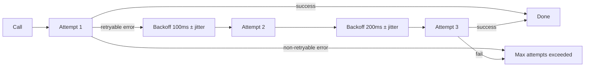
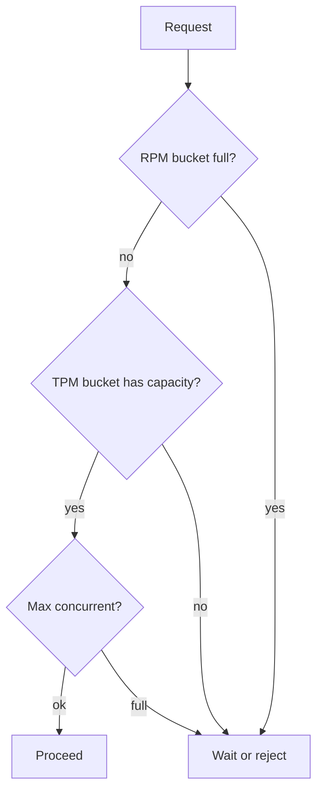
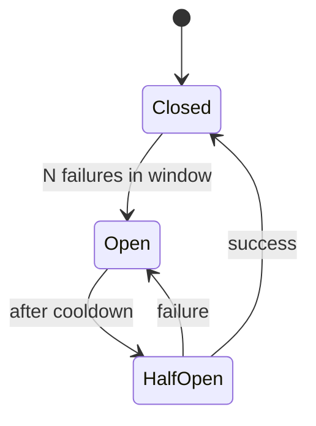
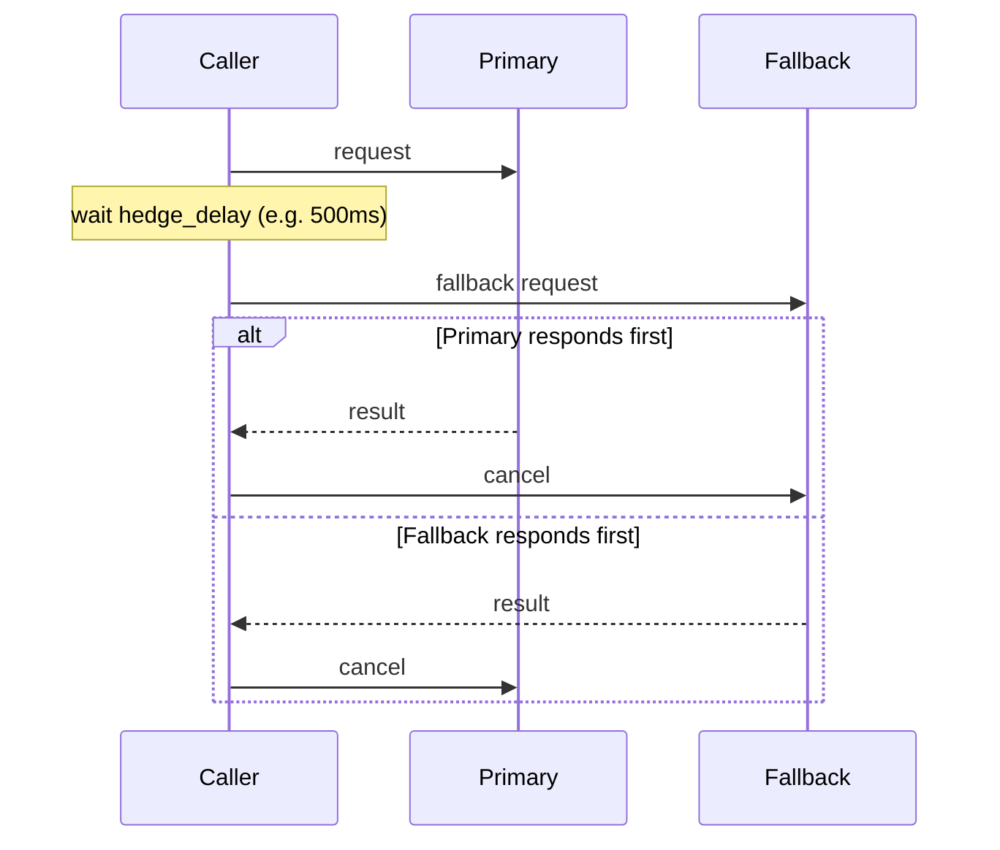

# Resilience

Resilience in Beluga is built from two pieces: the `resilience` package (`CircuitBreaker`, `Retry`, `Hedge`, `RateLimiter`) and middleware on the same `func(T) T` signature that wraps every extensible interface. You compose them by function application — there is no special infrastructure to deploy.

## The pattern

Extensible packages such as `llm` and `tool` ship an `ApplyMiddleware()` helper that wraps a base instance. The `llm` package provides `WithProviderLimits` (RPM and concurrency), `WithTracing`, `WithLogging`, `WithFallback` and `WithHooks`; retry and circuit breaking come from the `resilience` package, which you wrap into an `llm.Middleware` yourself:

```go
package main

import (
    "context"
    "log"
    "os"
    "time"

    "github.com/lookatitude/beluga-ai/v2/config"
    "github.com/lookatitude/beluga-ai/v2/llm"
    _ "github.com/lookatitude/beluga-ai/v2/llm/providers/anthropic"
    "github.com/lookatitude/beluga-ai/v2/resilience"
    "github.com/lookatitude/beluga-ai/v2/schema"
)

// resilientModel adds retry + circuit breaking to Generate. Stream,
// BindTools and ModelID pass through to the embedded model.
type resilientModel struct {
    llm.ChatModel
    cb     *resilience.CircuitBreaker
    policy resilience.RetryPolicy
}

func (m *resilientModel) Generate(ctx context.Context, msgs []schema.Message, opts ...llm.GenerateOption) (*schema.AIMessage, error) {
    return resilience.Retry(ctx, m.policy, func(ctx context.Context) (*schema.AIMessage, error) {
        out, err := m.cb.Execute(ctx, func(ctx context.Context) (any, error) {
            return m.ChatModel.Generate(ctx, msgs, opts...)
        })
        if err != nil {
            return nil, err
        }
        return out.(*schema.AIMessage), nil
    })
}

func withResilience(cb *resilience.CircuitBreaker, policy resilience.RetryPolicy) llm.Middleware {
    return func(next llm.ChatModel) llm.ChatModel {
        return &resilientModel{ChatModel: next, cb: cb, policy: policy}
    }
}

func main() {
    base, err := llm.New("anthropic", config.ProviderConfig{
        APIKey:  os.Getenv("ANTHROPIC_API_KEY"),
        Model:   "claude-sonnet-4-6",
        Timeout: 20 * time.Second,
    })
    if err != nil {
        log.Fatal(err)
    }

    resilient := llm.ApplyMiddleware(base,
        llm.WithProviderLimits(llm.ProviderLimits{RPM: 60, MaxConcurrent: 10}),
        withResilience(
            resilience.NewCircuitBreaker(5, 30*time.Second),
            resilience.DefaultRetryPolicy(), // honors core.IsRetryable()
        ),
    )

    resp, err := resilient.Generate(context.Background(), []schema.Message{
        schema.NewHumanMessage("Hello"),
    })
    if err != nil {
        log.Fatal(err)
    }
    log.Println(resp.Text())
}
```

## How retry decides what to retry



Beluga errors carry a typed `ErrorCode`. `resilience.Retry` calls `core.IsRetryable(err)` before re-running a call (unless you set `RetryPolicy.RetryableErrors`). Retryable codes are:

- `core.ErrRateLimit` — provider rate-limited the request
- `core.ErrProviderDown` — the upstream provider is unreachable
- `core.ErrTimeout` — the call exceeded its deadline

Non-retryable errors (`core.ErrInvalidInput`, `core.ErrAuth`, `core.ErrNotFound`, and plain errors without a code) propagate immediately. See [Errors](/docs/concepts/errors/) for the full model.

## Rate limiting



Three buckets per provider: **RPM** (requests per minute), **TPM** (tokens per minute), **MaxConcurrent** (simultaneous in-flight calls). Different providers gate on different things — the limiter takes the tightest constraint. `resilience.NewRateLimiter(resilience.ProviderLimits{...})` implements all three: `Allow` reserves a request and a concurrency slot, `Release` frees the slot, and `ConsumeTokens` charges tokens against the TPM budget. The `llm.WithProviderLimits` middleware enforces all three as well: it records each response's `Usage.TotalTokens` and stops admitting requests once the trailing-minute `TPM` budget is spent.

## Circuit breakers



Three states: **Closed** (normal, calls pass through), **Open** (fail fast with `resilience.ErrCircuitOpen` without calling the underlying service), **Half-Open** (cooldown elapsed; one probe call decides whether to close or re-open). `resilience.NewCircuitBreaker(failureThreshold, resetTimeout)` tracks failures and prevents a degraded provider from cascading slow failures upstream.

Circuit breakers operate per-instance, not per-process. Two `CircuitBreaker` values wrapping the same base provider are independent — useful when one chain has lower latency budget than another.

## Hedged requests

`resilience.Hedge(ctx, primary, secondary, delay)` fires the secondary function if the primary is still running after `delay`. Whichever succeeds first wins; the other is cancelled. Cuts P99 latency at up to 2× the base cost for calls that exceed the delay.



Best for search and retrieval where median latency is low but the tail is long.

## Composing with other middleware

Resilience composes with observability and logging middleware. Read outside-in:

```go
model := llm.ApplyMiddleware(base,
    llm.WithTracing(),                // gen_ai.* OTel spans
    llm.WithLogging(slog.Default()),
    llm.WithProviderLimits(llm.ProviderLimits{RPM: 60, MaxConcurrent: 10}),
    withResilience(cb, resilience.DefaultRetryPolicy()), // from the example above
)
```

The first middleware in the slice wraps the outside. Calls flow inward through tracing → logging → rate limit → retry/circuit breaker → base. Guard checks run in the agent pipeline rather than as `llm` middleware; see [Safety and guards](/docs/guides/production/safety-and-guards/).

## Related

- [Observability](/docs/guides/production/observability/) — wire OTel exporters
- [Errors](/docs/concepts/errors/) — the typed error model
- [Extensibility](/docs/concepts/extensibility/) — the four-ring composition model
