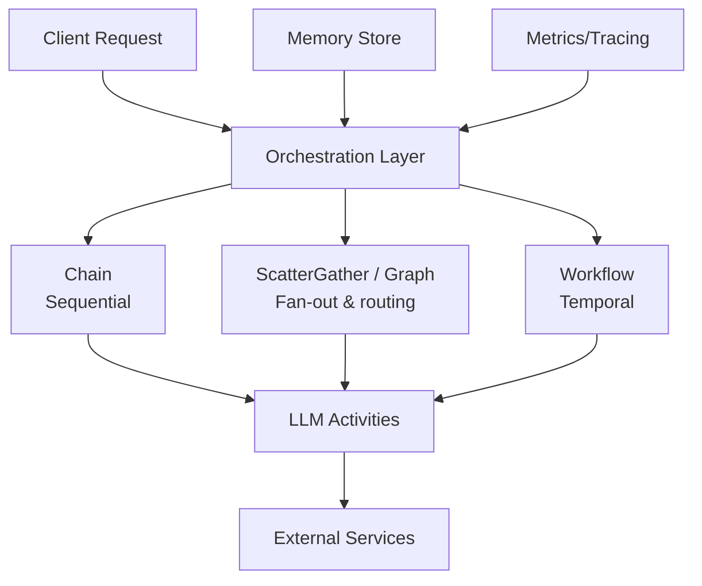

Enterprise applications require complex, long-running workflows that span multiple services, handle failures gracefully, and integrate intelligent decision-making. A typical order processing system, for example, must validate inventory, check credit, process payment, and fulfill the order — some steps in sequence, others in parallel, all with retry logic and state persistence across potential failures.

Traditional orchestration solutions (cron jobs, message queues, custom state machines) lack AI capabilities. Adding LLM-based decisions to these systems requires bolting on API calls with ad-hoc error handling, losing the benefits of structured workflow management. The result is fragile glue code that's hard to test, monitor, and recover from failures.

Beluga AI provides a complete orchestration layer with three patterns at different complexity levels, each with native LLM integration so AI-powered decisions are first-class workflow activities rather than external API calls.

## Solution Architecture

Beluga AI's orchestration layer supports three patterns, each suited to different complexity levels: **chains** (`orchestration.Chain`) for linear flows where each step feeds the next, **parallel fan-out** (`orchestration.NewScatterGather`, plus `orchestration.Graph` for conditional routing between steps) for independent work that can run concurrently, and **Temporal workflows** for distributed, fault-tolerant execution that survives process restarts. The choice depends on requirements: chains for simplicity, fan-out for throughput, Temporal for durability.



## Chain Orchestration

Chains execute steps sequentially, passing output from one step to the next. Use chains when the workflow is inherently linear — each step depends on the previous step's output and there's no opportunity for parallelism. Chains are the simplest orchestration pattern and the right default when you don't need parallel execution or conditional routing.

Every step is a `core.Runnable` (`Invoke` + `Stream`), so agents, models wrapped as runnables, and other chains compose freely. Plain functions need a small adapter, shown here as `stepFunc`. Timeouts come from the context and retries from `resilience.Retry`.

```go
package main

import (
    "context"
    "fmt"
    "iter"
    "log"
    "os"
    "time"

    "github.com/lookatitude/beluga-ai/v2/config"
    "github.com/lookatitude/beluga-ai/v2/core"
    "github.com/lookatitude/beluga-ai/v2/llm"
    "github.com/lookatitude/beluga-ai/v2/orchestration"
    "github.com/lookatitude/beluga-ai/v2/schema"

    _ "github.com/lookatitude/beluga-ai/v2/llm/providers/openai"
)

// stepFunc adapts a function to core.Runnable.
type stepFunc func(ctx context.Context, input map[string]any) (map[string]any, error)

func (f stepFunc) Invoke(ctx context.Context, input any, _ ...core.Option) (any, error) {
    m, ok := input.(map[string]any)
    if !ok {
        return nil, fmt.Errorf("step: expected map[string]any, got %T", input)
    }
    return f(ctx, m)
}

func (f stepFunc) Stream(ctx context.Context, input any, opts ...core.Option) iter.Seq2[any, error] {
    return func(yield func(any, error) bool) {
        yield(f.Invoke(ctx, input, opts...))
    }
}

func createOrderChain() (core.Runnable, error) {
    model, err := llm.New("openai", config.ProviderConfig{
        APIKey: os.Getenv("OPENAI_API_KEY"),
        Model:  "gpt-4o",
    })
    if err != nil {
        return nil, fmt.Errorf("create model: %w", err)
    }

    // Step 1: Validate order
    validate := stepFunc(func(ctx context.Context, input map[string]any) (map[string]any, error) {
        orderID, _ := input["order_id"].(string)
        if orderID == "" {
            return nil, fmt.Errorf("invalid order ID")
        }
        input["valid"] = true
        return input, nil
    })

    // Step 2: LLM-based decision for special handling
    decide := stepFunc(func(ctx context.Context, input map[string]any) (map[string]any, error) {
        orderValue, _ := input["order_value"].(float64)
        customerTier, _ := input["customer_tier"].(string)

        prompt := fmt.Sprintf("Order value: $%.2f, Customer tier: %s. Should this order receive expedited processing? Answer yes or no with brief reasoning.", orderValue, customerTier)

        resp, err := model.Generate(ctx, []schema.Message{
            schema.NewHumanMessage(prompt),
        })
        if err != nil {
            return nil, fmt.Errorf("llm decision: %w", err)
        }

        input["expedited"] = resp.Text()
        return input, nil
    })

    // Step 3: Process payment
    payment := stepFunc(func(ctx context.Context, input map[string]any) (map[string]any, error) {
        orderID, _ := input["order_id"].(string)
        paymentID, err := processPayment(ctx, orderID)
        if err != nil {
            return nil, err
        }
        input["payment_id"] = paymentID
        return input, nil
    })

    return orchestration.Chain(validate, decide, payment), nil
}

func runChain(ctx context.Context) error {
    chain, err := createOrderChain()
    if err != nil {
        return err
    }

    // The whole chain gets a 5-minute budget.
    ctx, cancel := context.WithTimeout(ctx, 5*time.Minute)
    defer cancel()

    result, err := chain.Invoke(ctx, map[string]any{
        "order_id":      "order-123",
        "order_value":   250.00,
        "customer_tier": "gold",
    })
    if err != nil {
        return fmt.Errorf("chain execution: %w", err)
    }

    log.Printf("Order processed: %v", result)
    return nil
}

// processPayment calls your payment service.
func processPayment(ctx context.Context, orderID string) (string, error) {
    return "pay-" + orderID, nil
}
```

## Parallel Fan-out and Routing

Use fan-out when independent steps can run concurrently — for example, checking inventory and verifying credit can happen in parallel since neither depends on the other, but payment processing must wait for both. `orchestration.NewScatterGather` runs its workers concurrently on the same input and hands all results to an aggregator; chaining it before the payment step expresses the dependency. (`core.Parallel` is the lower-level primitive that returns the raw `[]any`.)

`orchestration.Graph` is a different tool: it walks nodes one at a time along edges, picking the next node by each edge's `Condition`. Use it for routing (for example, sending high-value orders through a manual-review node), not for parallelism.

```go
func createOrderFlow(checkInventory, checkCredit, processPayment, manualReview, fulfill core.Runnable) (core.Runnable, error) {
    // Inventory and credit checks run concurrently.
    checks := orchestration.NewScatterGather(
        func(results []any) (any, error) {
            // Merge the two result maps into one order state.
            merged := map[string]any{}
            for _, r := range results {
                m, ok := r.(map[string]any)
                if !ok {
                    return nil, fmt.Errorf("unexpected check result %T", r)
                }
                for k, v := range m {
                    merged[k] = v
                }
            }
            return merged, nil
        },
        checkInventory, checkCredit,
    ).WithTimeout(30 * time.Second)

    // Route high-value orders through manual review before fulfillment.
    route := orchestration.NewGraph()
    for name, r := range map[string]core.Runnable{
        "payment": processPayment,
        "review":  manualReview,
        "fulfill": fulfill,
    } {
        if err := route.AddNode(name, r); err != nil {
            return nil, err
        }
    }
    isHighValue := func(v any) bool {
        m, _ := v.(map[string]any)
        value, _ := m["order_value"].(float64)
        return value > 10_000
    }
    for _, e := range []orchestration.Edge{
        {From: "payment", To: "review", Condition: isHighValue},
        {From: "payment", To: "fulfill"},
        {From: "review", To: "fulfill"},
    } {
        if err := route.AddEdge(e); err != nil {
            return nil, err
        }
    }
    if err := route.SetEntry("payment"); err != nil {
        return nil, err
    }

    return orchestration.Chain(checks, route), nil
}
```

## Temporal Workflow Integration

Chains, fan-out, and graphs run in-process — if the process crashes, in-flight workflow state is lost. For workflows that must survive process restarts, deployments, and infrastructure failures, Temporal provides durable execution with automatic state persistence, replay-based recovery, and automatic activity retries. The example below uses the Temporal Go SDK directly and calls a Beluga model inside an activity, so AI-powered decisions get the same durability guarantees as any other workflow step. Alternatively, write the workflow against Beluga's `workflow` package and run it on Temporal through the `workflow/providers/temporal` executor.

```go
package main

import (
    "context"
    "fmt"
    "os"
    "time"

    "github.com/lookatitude/beluga-ai/v2/config"
    "github.com/lookatitude/beluga-ai/v2/llm"
    "github.com/lookatitude/beluga-ai/v2/schema"

    _ "github.com/lookatitude/beluga-ai/v2/llm/providers/openai"

    "go.temporal.io/sdk/temporal"
    temporalWorkflow "go.temporal.io/sdk/workflow"
)

type Order struct {
    ID           string
    ProductID    string
    Value        float64
    CustomerTier string
}

type OrderResult struct {
    Status        string
    PaymentID     string
    FulfillmentID string
}

func OrderProcessingWorkflow(ctx temporalWorkflow.Context, order Order) (OrderResult, error) {
    ao := temporalWorkflow.ActivityOptions{
        StartToCloseTimeout: 60 * time.Second,
        RetryPolicy: &temporal.RetryPolicy{
            MaximumAttempts: 3,
        },
    }
    ctx = temporalWorkflow.WithActivityOptions(ctx, ao)

    // Step 1: Check inventory
    var inventoryAvailable bool
    err := temporalWorkflow.ExecuteActivity(ctx, CheckInventoryActivity, order.ProductID).Get(ctx, &inventoryAvailable)
    if err != nil {
        return OrderResult{}, err
    }

    if !inventoryAvailable {
        return OrderResult{Status: "out_of_stock"}, nil
    }

    // Step 2: LLM-based decision for special handling
    var decision string
    err = temporalWorkflow.ExecuteActivity(ctx, LLMDecisionActivity, order).Get(ctx, &decision)
    if err != nil {
        return OrderResult{}, err
    }

    // Step 3: Process payment
    var paymentID string
    err = temporalWorkflow.ExecuteActivity(ctx, ProcessPaymentActivity, order.ID).Get(ctx, &paymentID)
    if err != nil {
        return OrderResult{}, err
    }

    // Step 4: Fulfill order
    var fulfillmentID string
    err = temporalWorkflow.ExecuteActivity(ctx, FulfillOrderActivity, order.ID).Get(ctx, &fulfillmentID)
    if err != nil {
        return OrderResult{}, err
    }

    return OrderResult{
        Status:        "completed",
        PaymentID:     paymentID,
        FulfillmentID: fulfillmentID,
    }, nil
}

// LLM activity for intelligent decision-making
func LLMDecisionActivity(ctx context.Context, order Order) (string, error) {
    model, err := llm.New("openai", config.ProviderConfig{
        APIKey: os.Getenv("OPENAI_API_KEY"),
        Model:  "gpt-4o",
    })
    if err != nil {
        return "", err
    }

    prompt := fmt.Sprintf("Order value: $%.2f, Customer tier: %s. Determine if this order needs special handling.", order.Value, order.CustomerTier)

    resp, err := model.Generate(ctx, []schema.Message{
        schema.NewHumanMessage(prompt),
    })
    if err != nil {
        return "", err
    }

    return resp.Text(), nil
}
```

## Production Considerations

### Observability

Instrument workflows with OpenTelemetry for distributed tracing:

```go
import (
    "go.opentelemetry.io/otel"
    "go.opentelemetry.io/otel/attribute"
)

func ExecuteWithTracing(ctx context.Context, chain core.Runnable, input map[string]any) (any, error) {
    tracer := otel.Tracer("workflow")
    ctx, span := tracer.Start(ctx, "workflow.execute")
    defer span.End()

    span.SetAttributes(attribute.String("workflow.type", "chain"))

    result, err := chain.Invoke(ctx, input)
    if err != nil {
        span.RecordError(err)
        return nil, err
    }

    span.SetAttributes(attribute.String("workflow.status", "completed"))
    return result, nil
}
```

### Error Handling

Implement retries and circuit breakers for external service calls:

```go
import "github.com/lookatitude/beluga-ai/v2/resilience"

func robustProcessPayment(ctx context.Context, orderID string) (string, error) {
    policy := resilience.RetryPolicy{
        MaxAttempts:    3,
        InitialBackoff: 500 * time.Millisecond,
        MaxBackoff:     5 * time.Second,
        BackoffFactor:  2.0,
    }

    return resilience.Retry(ctx, policy, func(ctx context.Context) (string, error) {
        return processPayment(ctx, orderID)
    })
}
```

### Workflow State Management

Use Beluga AI's state package for shared workflow state with Watch support:

```go
import "github.com/lookatitude/beluga-ai/v2/state/providers/inmemory"

func workflowWithState(ctx context.Context) error {
    store := inmemory.New() // implements state.Store

    // Set initial state
    if err := store.Set(ctx, "workflow:status", "running"); err != nil {
        return err
    }

    // Watch for state changes
    changes := store.Watch(ctx, "workflow:status")
    go func() {
        for change, err := range changes {
            if err != nil {
                log.Printf("watch error: %v", err)
                return
            }
            log.Printf("Workflow status changed to: %v", change.Value)
        }
    }()

    // Execute workflow steps...

    return store.Set(ctx, "workflow:status", "completed")
}
```

### Configuration

```yaml
orchestration:
  chain:
    timeout: 300s
    max_retries: 3
  fanout:
    timeout: 30s
  workflow:
    temporal:
      address: "localhost:7233"
      namespace: "default"
      task_queue: "beluga-workflows"
    timeout: 3600s
    max_retries: 5

llm:
  provider: "openai"
  model: "gpt-4o"
  timeout: 30s
```

## Related Resources

- [Orchestration Package Guide](/docs/guides/orchestration/) for orchestration patterns
- [Agent Workflows](/docs/guides/agent-workflows/) for agent-based orchestration
- [Temporal Integration](/docs/guides/production/integrations/) for distributed workflow setup
